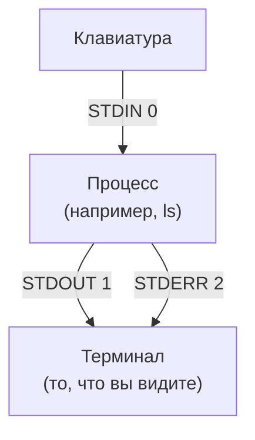
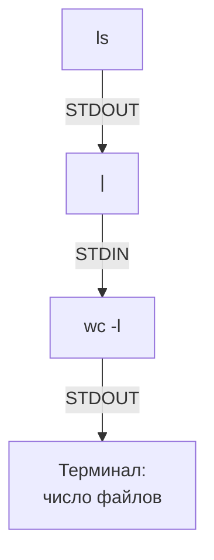
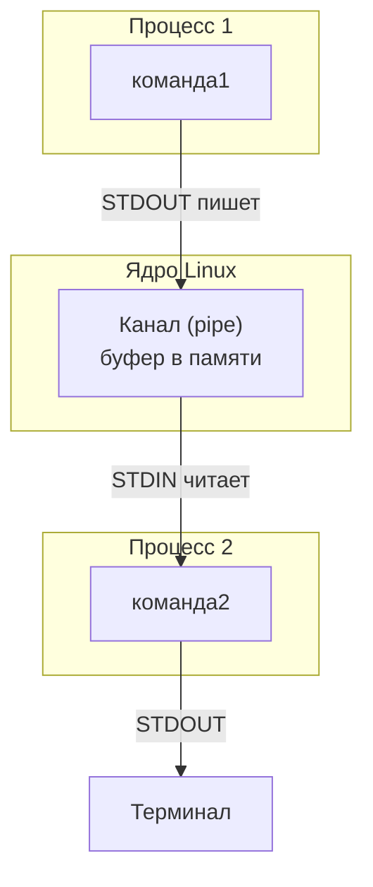
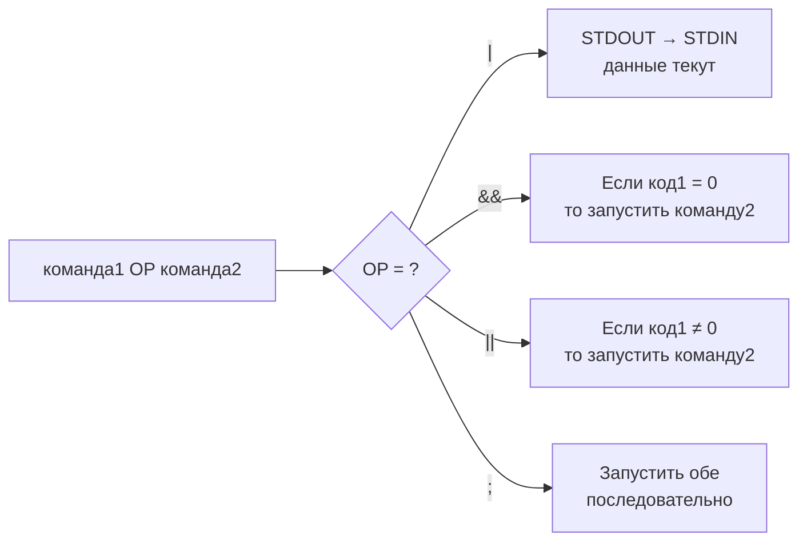
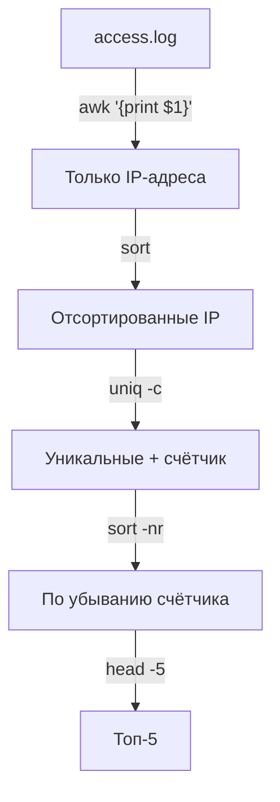
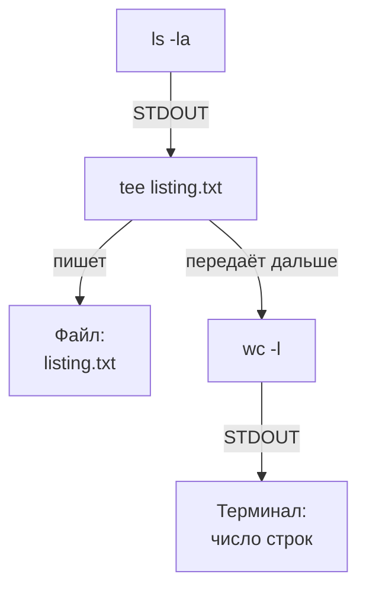
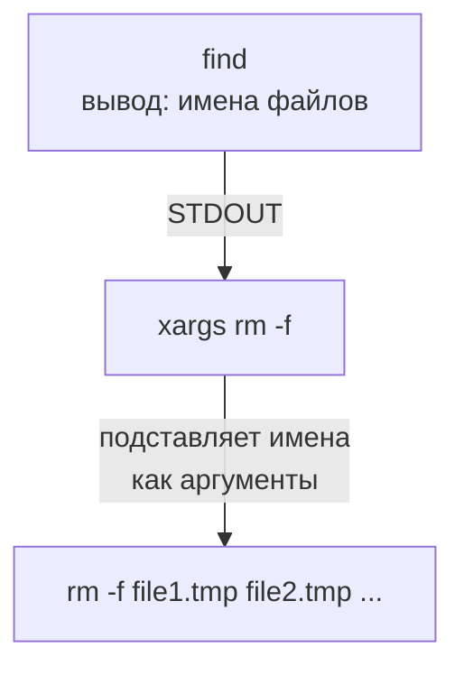
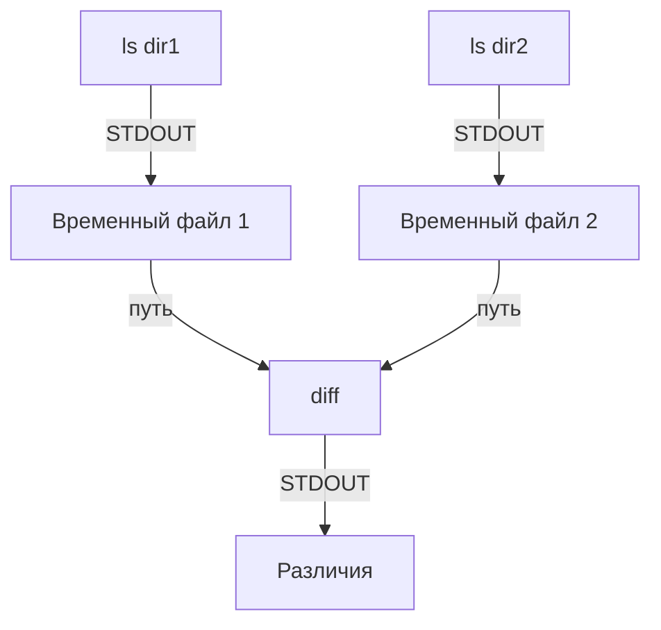
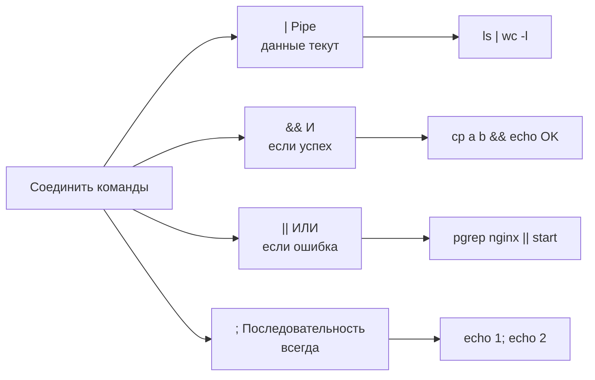
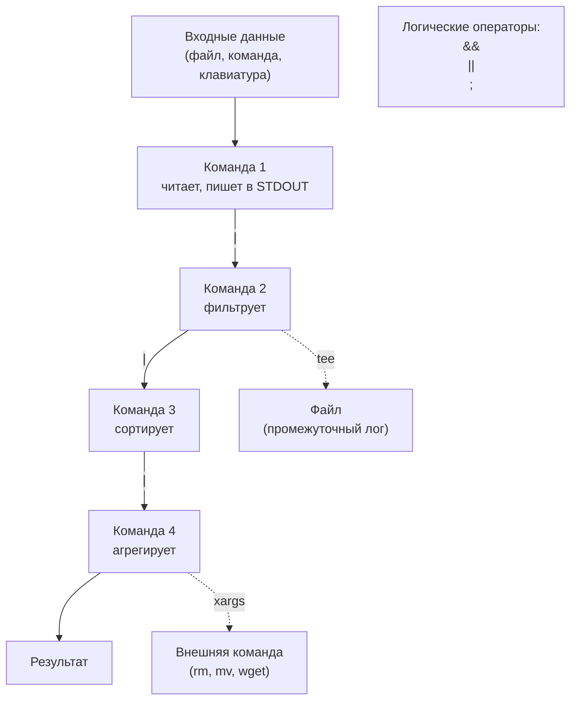

# PIPE И ЦЕПОЧКИ КОМАНД В LINUX

## 0. Прежде чем начать: что вам нужно знать

Этот документ не требует предварительных знаний. Всё, что нужно, объясняется по ходу. Единственное, что предполагается — вы умеете открыть терминал и ввести команду (например, `ls` или `echo hello`).

К концу документа вы будете понимать:
- что такое pipe (`|`),
- как данные текут между командами,
- чем pipe отличается от `&&`, `;`, `||`,
- как работают цепочки команд и почему они — главная сила Linux.

---

## 1. Фундамент: три потока данных

Прежде чем говорить о pipe, нужно понять, как вообще программы обмениваются данными. У каждого процесса в Linux есть **три стандартных потока** (их ещё называют «файловыми дескрипторами»).

| Поток | Номер | Назначение | По умолчанию подключён к... |
| :--- | :--- | :--- | :--- |
| **STDIN** | 0 | Стандартный ввод (что программа читает) | Клавиатуре |
| **STDOUT** | 1 | Стандартный вывод (что программа печатает) | Терминалу |
| **STDERR** | 2 | Стандартный вывод ошибок | Терминалу |

**Диаграмма: три потока одного процесса**



**Что это значит на практике.** Когда вы вводите `ls`, программа `ls`:
1. Читает аргументы (не из STDIN, а из командной строки),
2. Пишет список файлов в **STDOUT** (вы видите его на экране),
3. Если что-то не так (например, нет прав) — пишет сообщение в **STDERR** (тоже видно на экране).

По умолчанию и STDOUT, и STDERR идут в терминал. Именно поэтому вы видите и результат, и ошибки вперемешку. **Pipe позволяет перенаправить STDOUT одной команды на STDIN другой.**

---

## 2. Что такое pipe

**Pipe (`|`)** — это оператор, который соединяет STDOUT одной команды с STDIN другой.

**Простой пример:**
```bash
ls | wc -l
```
Здесь:
- `ls` выводит список файлов в STDOUT.
- `|` забирает этот вывод и подаёт его на STDIN команды `wc -l`.
- `wc -l` считает количество строк и печатает число.

**Диаграмма: как работает `ls | wc -l`**



**Ключевая идея:** `ls` не знает, что её вывод кто-то читает. `wc` не знает, откуда пришли данные. Они просто читают из STDIN и пишут в STDOUT. Pipe — это «труба» между ними.

---

## 3. Как работает pipe: механика

Когда вы пишете `команда1 | команда2`, происходят три вещи:

1. Оболочка (bash) запускает **обе команды одновременно** как отдельные процессы.
2. Между ними создаётся **канал** (pipe) — буфер в памяти ядра.
3. STDOUT первой команды подключается к этому каналу на запись. STDIN второй команды — на чтение.

**Диаграмма: механизм pipe**



**Важные следствия:**

- **Параллельность.** Обе команды работают одновременно. Пока `команда1` пишет первые строки, `команда2` уже их обрабатывает. Не нужно ждать завершения первой.
- **Потоковость.** Данные не сохраняются в файл — они текут через память. Это быстро.
- **Буферизация.** Если `команда2` медленная, буфер заполняется, и `команда1` приостанавливается. Это нормально.

---

## 4. Цепочки команд: не только pipe

Pipe — не единственный способ соединить команды. Есть ещё три оператора, и их важно не путать.

| Оператор | Название           | Что делает                                                      |
| :------- | :----------------- | :-------------------------------------------------------------- |
| \|       | Pipe               | STDOUT слева → STDIN справа                                     |
| `&&`     | Логическое И       | Выполнить правую команду, **только если** левая успешна (код 0) |
| \|\|     | Логическое ИЛИ     | Выполнить правую, **только если** левая упала (код ≠ 0)         |
| `;`      | Последовательность | Выполнить левую, затем правую — **независимо** от результата    |

**Диаграмма: сравнение четырёх операторов**



**Примеры:**
```bash
# Pipe: данные текут
ls | wc -l

# && : сделать бэкап, и только если успех — сообщить
cp file.txt file.bak && echo "Бэкап создан"

# || : проверить сервис, если упал — запустить
pgrep -x nginx || sudo systemctl start nginx

# ; : выполнить две независимые команды
echo "Первая"; echo "Вторая"
```

**Важно:** можно комбинировать. Например:
```bash
mkdir /tmp/backup && cp file.txt /tmp/backup/ && echo "OK" || echo "FAIL"
```
Это читается так: «создать папку И скопировать файл И сказать OK; если хоть что-то упало — сказать FAIL».

---

## 5. Многоступенчатые конвейеры

Главная сила pipe раскрывается, когда команд больше двух. Данные проходят через цепочку преобразований.

**Пример: топ-5 IP-адресов из лога**
```bash
awk '{print $1}' access.log | sort | uniq -c | sort -nr | head -5
```

**Диаграмма: что происходит на каждом шаге**



**Разбор по шагам:**

| Шаг | Команда | Что делает | Что на выходе |
| :--- | :--- | :--- | :--- |
| 1 | `awk '{print $1}'` | Берёт первый столбец | `10.0.0.5`, `192.168.1.1`, ... |
| 2 | `sort` | Сортирует по алфавиту | одинаковые IP стоят рядом |
| 3 | `uniq -c` | Считает повторы | `3 10.0.0.5`, `2 192.168.1.1` |
| 4 | `sort -nr` | Сортирует по числу (убывание) | `3 10.0.0.5`, `2 192.168.1.1` |
| 5 | `head -5` | Берёт первые 5 строк | топ-5 |

**Ключевое правило:** каждая команда в конвейере должна уметь читать из STDIN и писать в STDOUT. Тогда её можно вставить в любое место цепочки.

---

## 6. `tee`: раздвоение потока

Иногда нужно, чтобы данные шли **и дальше по конвейеру, и в файл одновременно**. Для этого есть `tee`.

**Пример:**
```bash
ls -la | tee listing.txt | wc -l
```
- `ls -la` пишет в STDOUT.
- `tee listing.txt` записывает всё в файл `listing.txt` **и** передаёт дальше.
- `wc -l` считает строки.

**Диаграмма: как работает tee**



**Зачем это нужно:** если конвейер длинный и вы хотите сохранить промежуточный результат для отладки.

**Флаг `-a`:** дописывать в файл, а не перезаписывать.
```bash
echo "новая строка" | tee -a log.txt
```

---

## 7. `xargs`: когда команда не читает STDIN

Не все команды умеют читать из STDIN. Например, `rm` ждёт аргументы (имена файлов), а не поток данных. Здесь на помощь приходит `xargs`.

**Проблема:**
```bash
find /tmp -name "*.tmp" | rm -f      # НЕ РАБОТАЕТ: rm не читает STDIN
```

**Решение:**
```bash
find /tmp -name "*.tmp" | xargs rm -f
```

**Что делает `xargs`:** читает STDIN, разбивает его на аргументы и передаёт их команде справа.

**Диаграмма: как работает xargs**



**Полезные флаги:**

| Флаг | Что делает |
| :--- | :--- |
| `-n 1` | Передавать по одному аргументу за раз |
| `-P 4` | Запускать 4 процесса параллельно |
| `-0` | Использовать `\0` как разделитель (для имён с пробелами) |
| `-I {}` | Подставлять аргумент в указанное место |

**Безопасная связка с `find`:**
```bash
find /tmp -name "*.tmp" -print0 | xargs -0 rm -f
```
`-print0` и `-0` нужны, чтобы имена с пробелами не ломали команду.

---

## 8. Подстановка процесса `<(...)`: pipe для команд, которые не читают STDIN

Некоторые команды (например, `diff`) принимают **имена файлов**, а не потоки. Чтобы сравнить вывод двух команд без создания временных файлов, используют подстановку процесса.

**Пример:**
```bash
diff <(ls dir1) <(ls dir2)
```

**Что происходит:**
- `<(...)` создаёт временный файл (или канал), содержащий вывод команды внутри.
- `diff` получает два пути к этим «файлам» и сравнивает их.

**Диаграмма: подстановка процесса**



**Важно:** подстановка процесса работает только в Bash, Zsh, Ksh. В `sh` (dash) — нет.

---

## 9. Типичные ошибки и как их избежать

### Ошибка 1: `cat` в начале конвейера (UUOC)

```bash
# Плохо:
cat file.txt | grep error

# Хорошо:
grep error file.txt
```

`cat` — лишний процесс. `grep` умеет читать файл напрямую.

---

### Ошибка 2: путать pipe и логические операторы

```bash
# НЕПРАВИЛЬНО: вы хотели "сделать A, потом B", но pipe соединяет потоки
ls | echo "Готово"    # echo выведет "Готово" и проигнорирует данные от ls

# ПРАВИЛЬНО:
ls && echo "Готово"
```

---

### Ошибка 3: пробелы вокруг `|` (не ошибка, но стиль)

```bash
ls|wc -l       # работает
ls | wc -l     # читаемее — используйте этот стиль
```

---

### Ошибка 4: `xargs` без `-0` на файлах с пробелами

```bash
# Сломается на "file with spaces.txt":
find . -name "*.txt" | xargs rm

# Правильно:
find . -name "*.txt" -print0 | xargs -0 rm
```

---

### Ошибка 5: pipe не передаёт STDERR

```bash
# Ошибки НЕ попадут в pipe:
ls /nonexistent | wc -l       # ошибка уйдёт в терминал, wc получит пустой ввод

# Если нужно объединить:
ls /nonexistent 2>&1 | wc -l  # ошибка уйдёт в pipe как обычный текст
```

---

## 10. Шпаргалка: операторы и их смысл



| Оператор | Что делает | Когда использовать |
| :--- | :--- | :--- |
| `\|` | Передаёт STDOUT слева в STDIN справа | Обработка данных |
| `&&` | Выполняет правую, если левая успешна | Цепочки зависимых действий |
| `\|\|` | Выполняет правую, если левая упала | Fallback, обработка ошибок |
| `;` | Выполняет обе независимо | Просто последовательность |

| Инструмент | Назначение |
| :--- | :--- |
| `\|` | Соединить STDOUT → STDIN |
| `tee` | Раздвоить поток (файл + дальше) |
| `xargs` | Превратить STDIN в аргументы команды |
| `<(cmd)` | Превратить вывод команды в «файл» |
| `2>&1` | Объединить STDERR и STDOUT |

---

## 11. Практика: от простого к сложному

Попробуйте выполнить эти команды и объяснить, что происходит на каждом шаге.

**Уровень 1: базовый pipe**
```bash
echo "hello world" | wc -w
ls /etc | head -5
```

**Уровень 2: два-три шага**
```bash
ls /etc | grep conf | wc -l
ps aux | grep bash | head -3
```

**Уровень 3: классический анализ логов**
```bash
cat > /tmp/test.log << 'EOF'
10.0.0.5 GET /index
192.168.1.1 GET /admin
10.0.0.5 POST /login
8.8.8.8 GET /error
192.168.1.1 GET /
10.0.0.5 GET /home
EOF

awk '{print $1}' /tmp/test.log | sort | uniq -c | sort -nr
```

**Уровень 4: `tee` + конвейер**
```bash
ls /etc | tee /tmp/etc_list.txt | wc -l
cat /tmp/etc_list.txt | head -3
```

**Уровень 5: `xargs`**
```bash
mkdir -p /tmp/xargs_demo && cd /tmp/xargs_demo
touch a.txt b.txt c.txt
find . -name "*.txt" | xargs ls -l
```

**Уровень 6: `diff` с подстановкой процесса**
```bash
mkdir -p /tmp/d1 /tmp/d2
touch /tmp/d1/{a,b,c}
touch /tmp/d2/{b,c,d}
diff <(ls /tmp/d1) <(ls /tmp/d2)
```

**Уровень 7: связка pipe + логика**
```bash
pgrep -x bash > /dev/null && echo "bash работает" || echo "bash не найден"
ps aux | grep -v grep | grep bash | awk '{print $2}' | head -1
```

---

## 12. Итоговая схема: всё вместе



---

## 13. Главное, что нужно запомнить

1. **Pipe (`|`)** соединяет STDOUT одной команды со STDIN другой. Данные текут, ничего не сохраняется на диск.
2. **Цепочка команд** — это несколько pipe подряд. Каждая команда — один шаг обработки.
3. **`&&`, `||`, `;`** — это НЕ pipe. Они управляют *порядком выполнения*, а не потоком данных.
4. **`tee`** раздваивает поток: одна копия в файл, другая — дальше.
5. **`xargs`** нужен, когда команда не читает STDIN, а ждёт аргументов.
6. **`<(cmd)`** превращает вывод команды в «файл» для тех команд, которые требуют имя файла.
7. **`2>&1`** — чтобы ошибки тоже попали в pipe.
8. **Избегайте `cat` в начале конвейера** — это лишний процесс.

---

## 14. Домашнее задание (для самопроверки)

1. Объясните своими словами, чем `|` отличается от `&&`.
2. Что выведет `echo "a b c" | wc -w` и почему?
3. Почему `ls /nonexistent | wc -l` выведет `0`, а не ошибку?
4. Как передать STDERR в pipe?
5. Что делает `tee -a`?
6. Когда нужен `xargs`, а когда можно обойтись pipe?
7. Почему `find ... | xargs rm` может быть опасен и как это исправить?
8. Напишите однострочник: найти топ-3 IP из лога `/tmp/test.log`.
9. Напишите однострочник: сохранить список файлов `/etc` в файл и одновременно посчитать их количество.
10. Сравните `ls /tmp/d1` и `ls /tmp/d2` без создания временных файлов.

Если после прочтения вы можете объяснить коллеге, что делает `awk '{print $1}' access.log | sort | uniq -c | sort -nr | head -5` — вы освоили pipe.