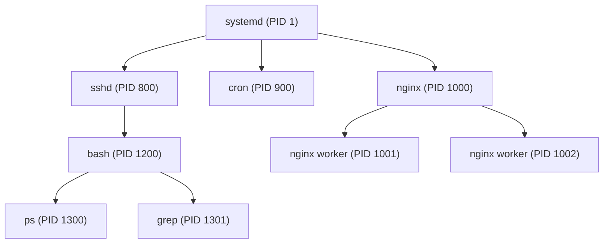
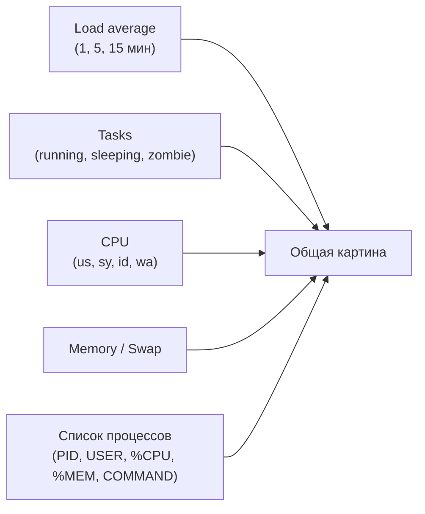
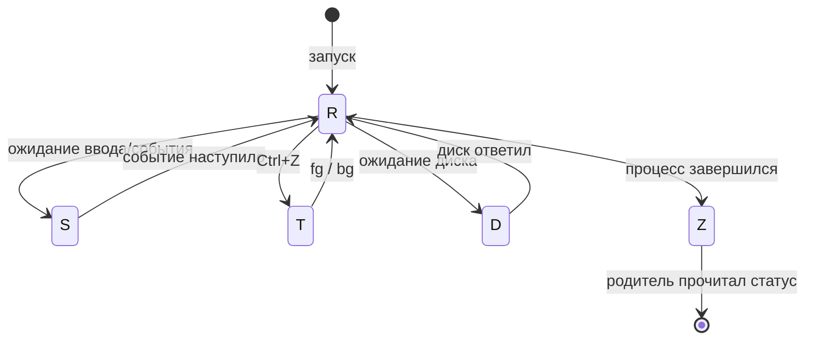
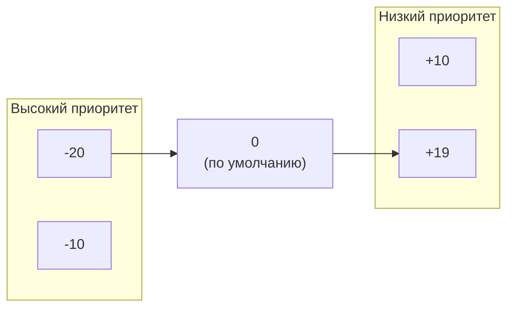
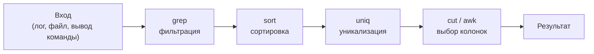
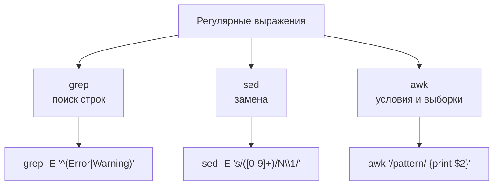
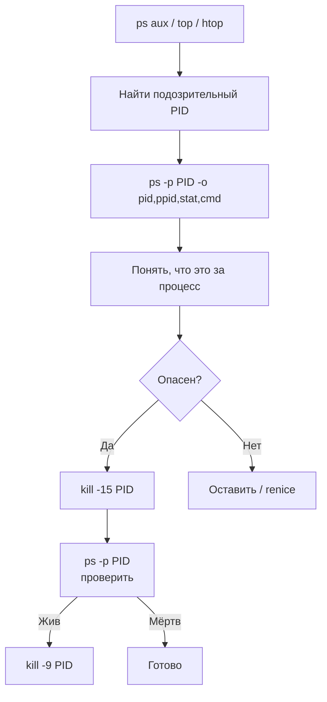

# Процессы и обработка текста в Linux

**Источник:** Уильям Шоттс, «Командная строка Linux. Полное руководство» — главы 10 (Процессы) и 20 (Обработка текста).

Процессы и обработка текста — две темы, которые в книге Шоттса идут раздельно, но в реальной работе они неразрывны. Вы запускаете процесс, он пишет лог, вы фильтруете лог через `grep`, сортируете через `sort`, вытаскиваете колонки через `awk`, и на основе этого принимаете решение — убить процесс или изменить его приоритет. 

### Что такое процесс и как он устроен

**Ключевые понятия:**
- Программа на диске vs процесс в памяти.
- PID (Process ID) и PPID (Parent Process ID).
- Иерархия: `init`/`systemd` (PID 1) — прародитель всех процессов.

**Диаграмма: иерархия процессов**



**Что показывает диаграмма:** каждый процесс имеет родителя, кроме PID 1. Когда вы запускаете команду в терминале, ваш `bash` становится родителем для этой команды.

---

### Статический обзор: `ps` 

**Два стиля флагов:**
- `ps aux` (BSD) — «что происходит во всей системе».
- `ps -ef` (System V) — «кто кого породил».

**Ключевые колонки `ps aux`:** `USER`, `PID`, `%CPU`, `%MEM`, `STAT`, `COMMAND`.

**Показать:**
```bash
ps aux | head -5
ps -ef | grep -v grep | grep bash
ps auxf | head -20          # дерево процессов
ps -eo pid,ppid,ni,stat,comm --sort=-%cpu | head
```

**Важно:** `ps` — это снимок. Он не обновляется.

---

### Динамический обзор: `top` и `htop` (15 мин)

**`top` — «диспетчер задач» в консоли.**
- `P` — сортировка по CPU.
- `M` — сортировка по памяти.
- `k` — kill.
- `r` — renice.
- `q` — выход.

**`htop` — цветной, с деревом (`F5`), убийством стрелками (`F9`), изменением приоритета (`F7`/`F8`).**

**Показать:**
```bash
top -b -n1 | head -20          # batch-режим, один снимок
htop                            # если установлен
```

**Диаграмма: что показывает `top`**



---

### Состояния процессов (STAT) — читаем «диагноз» (10 мин)

**Пять критических состояний:**

| Буква | Название | Что значит |
| :--- | :--- | :--- |
| `R` | Running | Выполняется или ждёт CPU. |
| `S` | Sleeping | Спит, ждёт события. Норма. |
| `D` | Uninterruptible Sleep | Ждёт диск/сеть. Нельзя прервать. |
| `Z` | Zombie | Завершился, родитель не прочитал статус. |
| `T` | Stopped | Остановлен (Ctrl+Z). |

**Диаграмма: переходы состояний**



**Показать:**
```bash
sleep 300 &
ps -o pid,stat,comm -p $!
```

---

### Сигналы: как общаться с процессами (15 мин)

**Три главных сигнала:**

| Сигнал | Номер | Эффект |
| :--- | :--- | :--- |
| SIGTERM | 15 | Вежливое завершение. **Всегда сначала 15.** |
| SIGKILL | 9 | Беспощадное убийство. Крайняя мера. |
| SIGHUP | 1 | Перечитать конфиг (для сервисов). |

**Инструменты:**
- `kill -15 PID` / `kill -9 PID`
- `killall nginx`
- `pkill -f "my_script.py"`

**Показать:**
```bash
sleep 600 &
PID=$!
kill -15 $PID
ps -p $PID || echo "убит"
```

**Предупреждение:** не убивайте PID 1 и свой SSH-демон.

---

### Приоритеты: `nice` и `renice` (10 мин)

**Nice value:** от -20 (высший приоритет) до +19 (низший). По умолчанию 0.

- `nice -n 10 ./heavy.sh` — запустить с низким приоритетом.
- `renice -n 5 -p 1234` — изменить приоритет работающего процесса.

**Диаграмма: шкала nice**



---

### Фоновые задачи и их жизнь (10 мин)

**Инструменты:**
- `command &` — запуск в фоне.
- `Ctrl+Z` — приостановить.
- `jobs` — список задач.
- `fg %1` — вернуть на передний план.
- `bg %2` — продолжить в фоне.

**Проблема SIGHUP:** закройте терминал — фоновые процессы умрут.
**Решения:**
- `nohup command &`
- `disown -h %1`
- `tmux` / `screen`

**Показать:**
```bash
sleep 300 &
jobs
disown -h %1
jobs
```


## Обработка текста: от «прочитать» до «преобразовать»

### Зачем нужна обработка текста

В Linux всё — текст: логи, конфиги, вывод команд. Умение фильтровать, сортировать и преобразовывать текст — это умение управлять системой.

**Философия конвейера:** каждая утилита делает одно, но хорошо. Соединяем через `|`.

**Диаграмма: конвейер обработки**



---

### Просмотр текста: `cat`, `less`, `head`, `tail`

| Команда | Назначение | Ключевой флаг |
| :--- | :--- | :--- |
| `cat` | Вывести всё (только маленькие файлы) | `cat f1 f2 > merged` |
| `less` | Постраничный просмотр | `/поиск`, `F` — слежение |
| `head` | Первые N строк | `head -n 50` |
| `tail` | Последние N строк | `tail -f` — живой лог |

**Показать:**
```bash
seq 1 100 > /tmp/nums.txt
head -5 /tmp/nums.txt
tail -3 /tmp/nums.txt
less /tmp/nums.txt
```

---

### Поиск и фильтрация: `grep`

**Ключевые флаги:**
- `-i` — игнорировать регистр.
- `-v` — инверсия.
- `-n` — номера строк.
- `-r` — рекурсивно.
- `-A/-B/-C N` — контекст.
- `-c` — счётчик.
- `-o` — только совпадение.
- `-E` — расширенный регексп.

**Показать:**
```bash
cat > /tmp/app.log << 'EOF'
2024-01-01 ERROR failed
2024-01-01 INFO started
2024-01-01 error lower
2024-01-01 FATAL panic
EOF

grep -i "error" /tmp/app.log
grep -n "FATAL" /tmp/app.log
grep -c "error" /tmp/app.log
grep -C1 "FATAL" /tmp/app.log
```

---

### Сортировка и уникализация: `sort` и `uniq` 

**Правило:** `uniq` работает только с отсортированными данными.

**Показать:**
```bash
printf "10.0.0.5\n192.168.1.1\n10.0.0.5\n8.8.8.8\n" > /tmp/ips.txt

sort /tmp/ips.txt | uniq -c | sort -nr
```

**Классический пайп «топ-IP»:**
```bash
awk '{print $1}' /tmp/app.log | sort | uniq -c | sort -nr | head
```

---

### Работа со столбцами: `cut` и `awk` 

**`cut`** — для простых случаев:
- `cut -d ',' -f 3 file.csv`
- `cut -d ' ' -f 1 access.log`

**`awk`** — для сложных:
- `awk '{print $2, $11}'`
- `awk -F ':' '{print $1, $3}' /etc/passwd`
- `awk '$5 > 1000 {print $1}'`
- `awk '{sum += $5} END {print sum}'`

**Показать:**
```bash
printf "1,Ivan,30\n2,Petr,25\n3,Anna,35\n" > /tmp/users.csv
cut -d ',' -f 2 /tmp/users.csv
awk -F ',' '{print $1, $3}' /tmp/users.csv
awk -F ',' '{sum += $3} END {print sum}' /tmp/users.csv
```

---

### Редактирование потока: `sed`

**Базовая замена:** `s/что/на_что/флаги` (`g` — глобально).

**Показать:**
```bash
printf "127.0.0.1 localhost\n127.0.0.1 test\nDEBUG line\n" > /tmp/config.conf

sed 's/127.0.0.1/0.0.0.0/g' /tmp/config.conf          # вывод на экран
sed -i.bak 's/127.0.0.1/0.0.0.0/g' /tmp/config.conf   # замена с бэкапом
sed -i '/DEBUG/d' /tmp/config.conf                     # удалить строки
sed -i '2s/test/prod/' /tmp/config.conf                # только 2-я строка
```

**Захват групп:**
```bash
echo "2024-01-15" | sed -E 's/([0-9]{4})-([0-9]{2})-([0-9]{2})/\3\/\2\/\1/'
```

---

### Регулярные выражения: склеиваем всё вместе 

**Базовые символы:**
- `.` — любой символ.
- `*` — 0+.
- `+` — 1+ (с `-E`).
- `?` — 0 или 1 (с `-E`).
- `^` — начало.
- `$` — конец.
- `[0-9]`, `[a-z]` — классы.

**Диаграмма: где какой регексп**



**Показать:**
```bash
grep "^Error" /tmp/app.log
grep "[0-9]$" /tmp/app.log
grep -E "^(ERROR|FATAL)" /tmp/app.log
```

---

### Большие объёмы: `xargs` и параллельность

**Проблема:** `find ... | xargs` ломается на пробелах.
**Решение:** `find ... -print0 | xargs -0`.

**Параллельность:**
- `xargs -P 4 -n1` — 4 процесса.
- `parallel` — мощнее.

**Показать:**
```bash
mkdir -p "/tmp/dir with spaces" && touch "/tmp/dir with spaces/file.txt"
find /tmp -name "*.txt" -print0 | xargs -0 ls -l
```


## Связка: процессы + текст в реальной работе

### Мониторинг через текст

**Задача:** найти процесс, который ест CPU, и разобраться, что он делает.

```bash
ps aux --sort=-%cpu | head -5 | awk '{print $2, $3, $11}'
```

**Задача:** посмотреть, какие порты слушаются, и отфильтровать:

```bash
ss -tulpn | grep LISTEN | awk '{print $1, $5}'
```

**Диаграмма: полный цикл «найти — понять — убить»**




## Итоговое практическое задание

**Задача:** Написать скрипт `analyze.sh`, который:
1. Запускает `sleep 600` в фоне.
2. Находит его PID через `pgrep -x sleep`.
3. Выводит через `ps -o pid,ppid,stat,%cpu,%mem,cmd -p PID`.
4. Меняет приоритет через `renice -n 10 -p PID`.
5. Проверяет, что приоритет изменился (`ps -o pid,ni -p PID`).
6. Убивает процесс через `kill -15`.
7. Логирует все действия с временными метками в файл.

**Проверка:** запустить с `bash -x`, убедиться, что все шаги выполнены.

---

## Приложение: шпаргалка

| Задача | Команда |
| :--- | :--- |
| Дерево процессов | `ps auxf` |
| Топ по CPU | `ps aux --sort=-%cpu \| head` |
| Живой мониторинг | `top` / `htop` |
| Убить вежливо | `kill -15 PID` |
| Убить жёстко | `kill -9 PID` |
| Понять, чем занят PID | `ps -p PID -o pid,ppid,stat,cmd` |
| Понизить приоритет | `renice -n 10 -p PID` |
| Найти процесс | `pgrep -af pattern` |
| Топ IP из лога | `awk '{print $1}' log \| sort \| uniq -c \| sort -nr \| head` |
| Замена в файле с бэкапом | `sed -i.bak 's/old/new/g' file` |
| Только ошибки из лога | `grep -i error log` |
| Контекст ошибки | `grep -C3 error log` |
| Сумма по колонке | `awk '{sum+=$3} END {print sum}' file` |
