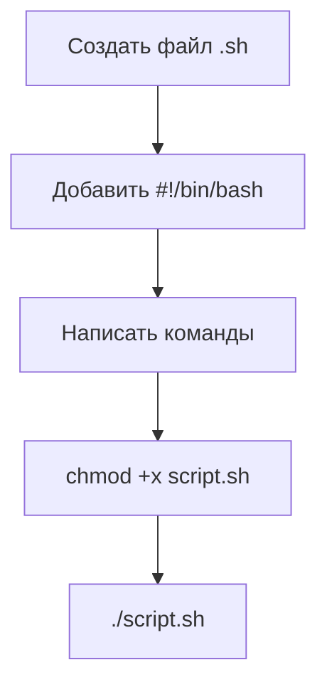
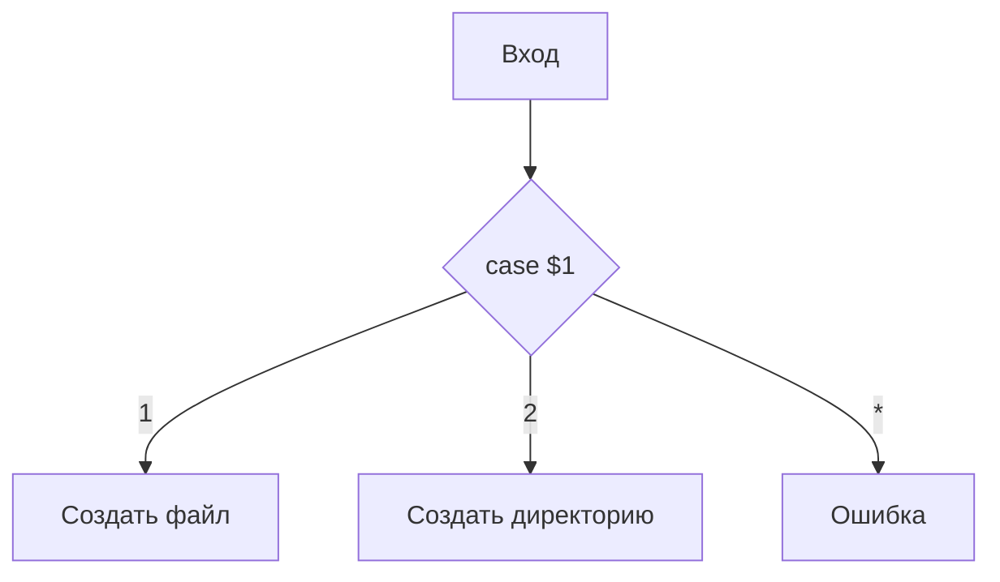
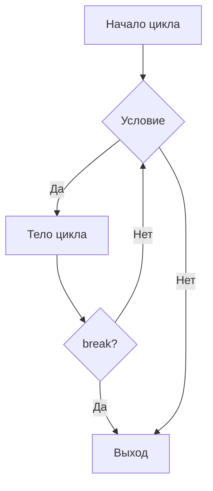

## 1. Зачем нужны скрипты

- **Автоматизация рутины** — если операция повторяется, она должна быть в скрипте.
- **Скрипт = текстовый файл** с командами, которые оболочка выполняет построчно.
- **Оболочка (shell)** — интерпретатор между пользователем и ядром.


---

## 2. Скелет любого скрипта

- **Шебанг** — первая строка, указывает интерпретатор.
  - `#!/bin/bash` — стандарт.
  - `#!/usr/bin/env bash` — переносимость между системами.
- **Права на запуск**: `chmod +x script.sh`.
- **Строгий режим**: `set -euo pipefail` — выход при ошибке, необъявленной переменной, сбое в пайпе.



---

## 3. Переменные и аргументы

- **Переменная** — именованная область памяти.
  - Присвоение: `NAME="value"` (без пробелов вокруг `=`).
  - Чтение: `"$NAME"` или `"${NAME}"` — кавычки обязательны.
- **Аргументы скрипта**:

| Переменная | Значение |
| :--- | :--- |
| `$0` | Имя скрипта |
| `$1`, `$2`… | Позиционные аргументы |
| `$#` | Количество аргументов |
| `$@` | Все аргументы как отдельные строки |
| `$*` | Все аргументы как одна строка |

**Пример:**
```bash
#!/bin/bash
echo "Скрипт: $0"
echo "Первый аргумент: $1"
echo "Всего аргументов: $#"
```

---

## 4. Ветвления: `if` и `case`

- **`if`** — проверка условия.
- **Основные проверки**:

| Категория | Примеры                                           |
| :-------- | :------------------------------------------------ |
| Строки    | `-z` (пусто), `-n` (не пусто), `==`, `!=`         |
| Числа     | `-eq`, `-ne`, `-lt`, `-gt`, `-le`, `-ge`          |
| Файлы     | `-f` (файл), `-d` (директория), `-e` (существует) |
| Логика    | `!` (НЕ), `&&` (И), \|\| (ИЛИ)                    |

**Пример:**
```bash
if [[ -f "$1" ]]; then
    echo "Это файл"
elif [[ -d "$1" ]]; then
    echo "Это директория"
else
    echo "Неизвестный объект"
fi
```

- **`case`** — аналог `switch` для множества вариантов.



---

## 5. Циклы: `for` и `while`

- **`for`** — перебор списка значений.
  - Простой список: `for i in a b c`.
  - Список из команды: `for f in $(ls)`.
  - **C-стиль**: `for ((i=0; i<10; i++))`.
- **`while`** — выполняется, пока условие истинно.

**Пример:**
```bash
for file in /var/log/*.log; do
    echo "Обработка: $file"
done
```

- **Управление циклом**: `break` (выйти), `continue` (пропустить итерацию).



---

## 6. Ввод и вывод: три потока

- **STDIN (0)** — ввод (клавиатура).
- **STDOUT (1)** — обычный вывод (экран).
- **STDERR (2)** — ошибки (экран).


**Перенаправление:**

| Команда | Что делает |
| :--- | :--- |
| `> file` | STDOUT в файл (перезапись) |
| `>> file` | STDOUT в файл (добавление) |
| `2> file` | STDERR в файл |
| `2>&1` | STDERR туда же, куда STDOUT |
| `&> file` | STDERR и STDOUT в один файл |

**Пример:**
```bash
ls /nonexistent 2> error.log
```

---

## 7. Практический пример: скрипт мониторинга диска

**Задача:** найти топ-10 папок по размеру в заданных директориях.

**Логика:**
1. Задать список директорий: `MY_DIRECTORIES="/home /var/log"`.
2. Для каждой директории выполнить:
   - `du -S "$DIR"` — размеры подпапок.
   - `sort -rn` — сортировка по убыванию.
   - `sed` — оставить первые 10 строк и добавить нумерацию.
   - `awk` — форматирование вывода.

**Схема:**


## Результат

```bash
#!/bin/bash
MY_DIRECTORIES="/home /var/log"
echo "Top Ten Disk Space Usage"
for DIR in $MY_DIRECTORIES
do
echo "The $DIR Directory:"
du -S $DIR 2>/dev/null |
sort -rn |
sed '{11,$D; =}' |
sed 'N; s/\n/ /' |
awk '{printf $1 ":" "\t" $2 "\t" $3 "\n"}'
done
exit
```

---

## 8. Культура написания скриптов

- **Проверяйте аргументы** — если скрипт ждёт 2 аргумента, а получил 1, он должен сказать об этом.
- **Логируйте всё** — ошибки в `stderr`,重要 действия в лог.
- **Обрабатывайте ошибки** — `set -e`, `trap`, `exit 1` при сбое.
- **Dry-run для опасных операций** — сначала `-print`, потом `-delete`.
- **Отладка** — `bash -n` (синтаксис), `bash -x` (трассировка).

---

## 9. Итоговая шпаргалка

| Тема | Ключевые элементы |
| :--- | :--- |
| Скелет | `#!/bin/bash`, `set -euo pipefail`, `chmod +x` |
| Переменные | `$1`, `$#`, `$@`, кавычки |
| Ветвления | `if [[ -f ]]`, `case` |
| Циклы | `for`, `while`, `break`, `continue` |
| Потоки | `>`, `>>`, `2>`, `2>&1` |
| Практика | `du`, `sort`, `awk`, `sed` в конвейере |
