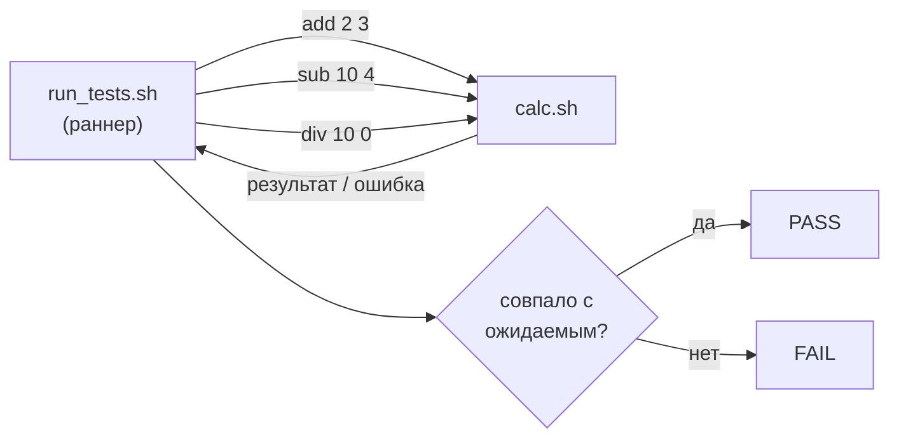
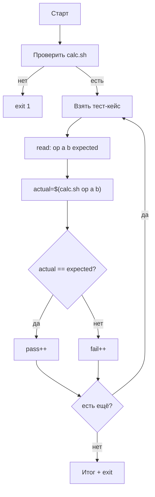
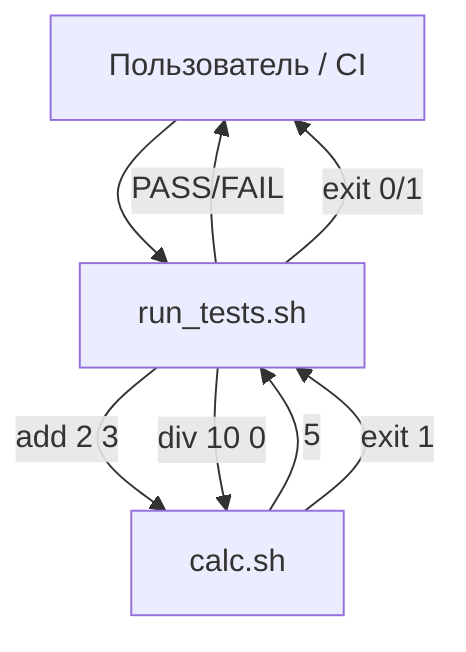

# Скрипт-раннер, вызывающий другой скрипт с разными параметрами

**Сценарий:** есть скрипт-калькулятор `calc.sh`, который принимает операцию и два числа. Нужен раннер `run_tests.sh`, который прогоняет набор тест-кейсов, сравнивает фактический вывод с ожидаемым и выносит вердикт.



---

## 1. Скрипт под тестом: `calc.sh`

**Задача:** принять 3 аргумента, выполнить операцию, вывести результат или ошибку.

**Ключевые тезисы:**
- Проверка количества аргументов (`$# -ne 3`) → ошибка с кодом 1.
- `case` по операции: `add`, `sub`, `mul`, `div`.
- Деление на ноль — отдельная проверка → ошибка.
- Неизвестная операция → ошибка.
- При успехе — вывод результата, код 0.

**Рамочно:**
```bash
#!/bin/bash
set -euo pipefail
# проверка $# -ne 3 → exit 1
# case "$1" in add|sub|mul|div ... *) exit 1
# проверка деления на ноль для div
```

---

## 2. Тест-раннер: `run_tests.sh`

**Ключевые тезисы:**
- Массив тест-кейсов: каждый — строка `"операция a b ожидаемый_результат"`.
- Цикл `for` по массиву.
- Захват вывода через `$(...)`.
- Сравнение через `[[ "$actual" == "$expected" ]]`.
- Счётчики `PASS`/`FAIL`.
- `exit 1`, если есть хотя бы один FAIL — для интеграции с CI.

---

### Шаг 1. Шебанг и строгий режим

```bash
#!/bin/bash
set -euo pipefail
```
Как в любом скрипте: защита от ошибок и необъявленных переменных.

---

### Шаг 2. Определить путь к скрипту под тестом

```bash
TARGET="./calc.sh"
```

**Почему переменная:** если `calc.sh` переедет, меняется одна строка. Можно задавать через `$1`, но для примера хардкод удобнее.

---

### Шаг 3. Проверить, что скрипт существует и исполняем

```bash
[[ -x "$TARGET" ]] || { echo "Нет $TARGET" >&2; exit 1; }
```

**Почему:** без этого первая же итерация упадёт с невнятной ошибкой. `-x` проверяет и наличие, и право на запуск.

---

### Шаг 4. Объявить массив тест-кейсов

```bash
TESTS=(
    "add 2 3 5"
    "sub 10 4 6"
    "mul 5 5 25"
    "div 10 2 5"
    "div 10 0 ERROR"
    "unknown 1 1 ERROR"
)
```

**Формат:** «операция a b ожидаемый_результат». Ожидаемый `ERROR` — значит скрипт должен упасть с ненулевым кодом.

---

### Шаг 5. Завести счётчики

```bash
pass=0
fail=0
```

**Почему:** в конце нужно понять, всё ли прошло. Счётчики дают итог и код возврата.

---

### Шаг 6. Цикл по тест-кейсам

```bash
for t in "${TESTS[@]}"; do
    read -r op a b expected <<< "$t"
    ...
done
```

**Что делает `read`:** разбивает строку на 4 переменные по пробелам. `<<<` — здесь-строка, передаёт строку на STDIN `read`. Это проще, чем `cut` или `awk`.

---

### Шаг 7. Вызвать тестируемый скрипт

```bash
actual=$("$TARGET" "$op" "$a" "$b" 2>/dev/null) || actual="ERROR"
```

**Разбор:**
- `$(...)` — захват STDOUT.
- `2>/dev/null` — ошибки не нужны в выводе, они и так сигнализируют о сбое.
- `|| actual="ERROR"` — если `calc.sh` вернул ненулевой код, ставим `ERROR`. Это унифицирует обработку ошибок и результата.

**Важно:** `set -e` не прервёт скрипт здесь, потому что `||` перехватывает ошибку.

---

### Шаг 8. Сравнить и посчитать

```bash
if [[ "$actual" == "$expected" ]]; then
    echo "PASS: $t"
    ((pass++))
else
    echo "FAIL: $t (получено: $actual)"
    ((fail++))
fi
```

**Почему `((pass++))` работает под `set -e`:** если `pass=0`, то `((pass++))` вернёт 1 (пост-инкремент возвращает старое значение, а `0` — это «ложь»). Есть подводный камень. Безопаснее: `pass=$((pass+1))`.

**Исправленный вариант:**
```bash
pass=$((pass + 1))
fail=$((fail + 1))
```

---

### Шаг 9. Итоговый отчёт и код возврата

```bash
echo "Итого: PASS=$pass, FAIL=$fail"
[[ $fail -eq 0 ]] || exit 1
```

**Почему `exit 1`:** CI и cron смотрят на код возврата. Если хоть один тест провален — скрипт должен вернуть ненулевой код.

---

## 3. Диаграмма потока выполнения



---

## 4. Ключевые приёмы, которые здесь показаны

| Приём | Где используется | Зачем |
| :--- | :--- | :--- |
| Вызов другого скрипта с параметрами | `"$TARGET" "$op" "$a" "$b"` | Эмуляция реального сценария |
| Захват вывода | `$(...)` | Сравнить с ожидаемым |
| Унификация ошибок | `\|\| actual="ERROR"` | Один формат для успеха и сбоя |
| Разбор строки | `read -r op a b expected <<< "$t"` | Проще, чем `cut`/`awk` |
| Массив тест-кейсов | `TESTS=(...)` | Легко добавлять новые |
| Код возврата | `exit 1` при `fail > 0` | CI и cron видят результат |
| Счётчики | `pass`/`fail` | Итоговая сводка |

---

## 5. Как расширять

- **Добавить тест-кейс** — одна строка в массив `TESTS`.
- **Разные наборы** — вынести `TESTS` в отдельный файл и читать через `while read`.
- **Проверка stderr** — захватывать `2>&1` и проверять текст ошибки.
- **Параллельный запуск** — `xargs -P 4` по массиву тестов (осторожно с выводом).
- **Цветной вывод** — `\033[0;32mPASS\033[0m` / `\033[0;31mFAIL\033[0m`.
- **Интеграция с CI** — `exit 1` уже есть; достаточно запустить `./run_tests.sh` в pipeline.

---

## 6. Схема «кто кого вызывает»



**Главное:** раннер ничего не знает о внутренностях `calc.sh`. Он знает только контракт: «при таких аргументах — такой вывод и такой код возврата». Это и есть принцип тестирования через чёрный ящик.
