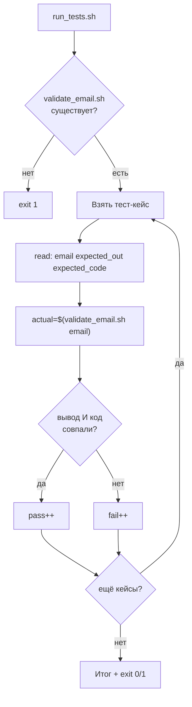

# Задача 1. Тестирование валидатора email

## 1.1. Входные и выходные данные

### Скрипт под тестом: `validate_email.sh`

| Параметр | Описание |
| :--- | :--- |
| **Вход** | Один аргумент — строка с email-адресом |
| **Выход (STDOUT)** | `VALID` — если адрес корректен, `INVALID` — если нет |
| **Код возврата** | `0` — валиден, `1` — невалиден или неверное число аргументов |
| **STDERR** | Сообщение об ошибке при неверном числе аргументов |

**Правила валидности (упрощённые):**
- Есть ровно один символ `@`.
- До `@` — минимум один символ.
- После `@` — минимум один символ, есть точка.
- Нет пробелов.

### Раннер: `run_tests.sh`

| Параметр | Описание |
| :--- | :--- |
| **Вход** | Нет аргументов (тест-кейсы зашиты в массив) |
| **Выход (STDOUT)** | Строки `PASS: <кейс>` / `FAIL: <кейс> (получено: <actual>)` + итоговая сводка |
| **Код возврата** | `0` — все тесты прошли, `1` — есть хотя бы один FAIL или целевой скрипт не найден |

---

## 1.2. Пошаговое создание `validate_email.sh`

### Шаг 1. Шебанг и строгий режим

Создайте файл `validate_email.sh`. Первая строка — `#!/bin/bash`. Вторая — `set -euo pipefail`. Строгий режим нужен, чтобы скрипт не продолжал работу после сбоя.

**Рамочно:**
```bash
#!/bin/bash
set -euo pipefail
```

### Шаг 2. Проверить количество аргументов

Если `$# -ne 1` — вывести в `stderr` сообщение «Usage: ...» и выйти с кодом 1. Это защита от запуска без аргумента или с лишними.

**Рамочно:**
```bash
if [ $# -ne 1 ]; then ... fi
```

### Шаг 3. Захватить email в переменную

Присвойте `EMAIL="$1"`. Дальше работаем с этой переменной, чтобы не путаться с позиционными аргументами.

### Шаг 4. Проверить на пробелы

Если строка содержит пробел — сразу `INVALID`. Используйте `[[ "$EMAIL" == *" "* ]]` или регулярку. Без этой проверки `a @b.com` пройдёт как валидный.

**Рамочно:**
```bash
if [[ "$EMAIL" =~ [[:space:]] ]]; then ... fi
```

### Шаг 5. Проверить количество `@`

Подсчитайте символы `@` через `grep -o "@"` и `wc -l` или через `awk`. Если их не ровно один — `INVALID`.

**Рамочно:**
```bash
count=$(echo "$EMAIL" | grep -o "@" | wc -l)
```

### Шаг 6. Разделить на локальную часть и домен

Используйте `cut -d '@' -f 1` и `-f 2` или подстановку `${EMAIL%@*}` / `${EMAIL#*@}`. Получите `LOCAL` и `DOMAIN`.

### Шаг 7. Проверить локальную часть и домен

- `LOCAL` не пустая (`[ -n "$LOCAL" ]`).
- `DOMAIN` не пустой и содержит точку (`[[ "$DOMAIN" == *.* ]]`).

Если хоть одно условие нарушено — `INVALID`, код 1.

### Шаг 8. Вывести результат и код

При успехе — `echo "VALID"` и `exit 0`. При любом провале — `echo "INVALID"` и `exit 1`.

### Шаг 9. Сделать исполняемым и проверить вручную

`chmod +x validate_email.sh`. Прогоните вручную:
```bash
./validate_email.sh user@example.com    # VALID, код 0
./validate_email.sh invalid            # INVALID, код 1
echo $?
```

---

## 1.3. Пошаговое создание `run_tests.sh`

### Шаг 1. Шебанг и строгий режим

`#!/bin/bash` и `set -euo pipefail`. Как обычно.

### Шаг 2. Определить путь к целевому скрипту

`TARGET="./validate_email.sh"`. Одна переменная — легко менять.

### Шаг 3. Проверить, что целевой скрипт существует и исполняем

`[[ -x "$TARGET" ]] || { echo "..." >&2; exit 1; }`. Без этого первый же тест упадёт с невнятной ошибкой.

### Шаг 4. Объявить массив тест-кейсов

Формат: `"email ожидаемый_вывод ожидаемый_код"`. Примеры (*дополнить список своими*):
- `"user@example.com VALID 0"`
- `"invalid INVALID 1"`
- `"a@b.com VALID 0"`
- `"@example.com INVALID 1"`
- `"user@ INVALID 1"`
- `"user@@example.com INVALID 1"`
- `"user name@example.com INVALID 1"`

**Рамочно:**
```bash
TESTS=(
    "user@example.com VALID 0"
    ...
)
```

### Шаг 5. Завести счётчики

`pass=0` и `fail=0`. В конце они дадут итог и код возврата.

### Шаг 6. Цикл по тест-кейсам

`for t in "${TESTS[@]}"; do ... done`. Внутри — `read -r email expected_out expected_code <<< "$t"`. `read` разбивает строку по пробелам на три переменные; `<<<` передаёт строку на STDIN.

**Рамочно:**
```bash
for t in "${TESTS[@]}"; do
    read -r email expected_out expected_code <<< "$t"
    ...
done
```

### Шаг 7. Вызвать целевой скрипт и захватить вывод и код

```bash
actual_out=$("$TARGET" "$email" 2>/dev/null) || actual_code=$?
actual_code=${actual_code:-0}
```

**Разбор:**
- `$(...)` — захват STDOUT.
- `2>/dev/null` — ошибки не нужны.
- `|| actual_code=$?` — если скрипт вернул ненулевой код, запоминаем его.
- `${actual_code:-0}` — если код не был выставлен (успех), считаем 0.

**Важно:** под `set -e` конструкция `||` перехватывает ошибку, скрипт не прерывается.

### Шаг 8. Сравнить вывод и код

Оба должны совпасть:
```bash
if [[ "$actual_out" == "$expected_out" && "$actual_code" -eq "$expected_code" ]]; then
    echo "PASS: $t"
    pass=$((pass + 1))
else
    echo "FAIL: $t (получено: out='$actual_out', code=$actual_code)"
    fail=$((fail + 1))
fi
```

**Почему оба:** только вывод или только код недостаточно. Скрипт может вывести `VALID`, но вернуть код 1 — это баг.

**Важно:** используйте `pass=$((pass + 1))`, а не `((pass++))`. Под `set -e` пост-инкремент с нуля вернёт «ложь» и прервёт скрипт.

### Шаг 9. Итоговая сводка и код возврата

```bash
echo "Итого: PASS=$pass, FAIL=$fail"
[[ $fail -eq 0 ]] || exit 1
```

**Почему `exit 1`:** CI и cron видят код возврата. Если есть провалы — скрипт должен упасть.

### Шаг 10. Сделать исполняемым и запустить

`chmod +x run_tests.sh`. Запустите `./run_tests.sh`. Проверьте, что все кейсы прошли. Затем специально сломайте `validate_email.sh` (например, уберите проверку на `@`) и убедитесь, что раннер поймал регрессию.

---

## 1.4. Схема работы



---

# Чек-лист для задач

- [ ] Целевой скрипт проверяет число аргументов и выводит `Usage` при ошибке.
- [ ] Целевой скрипт возвращает разные коды для успеха и провала.
- [ ] Раннер проверяет существование и исполняемость целевого скрипта.
- [ ] Раннер хранит тест-кейсы в массиве.
- [ ] Раннер захватывает и вывод, и код возврата.
- [ ] Раннер сравнивает оба.
- [ ] Раннер считает `pass`/`fail` через `$((...))`, а не `((++))`.
- [ ] Раннер возвращает `exit 1` при наличии провалов.
- [ ] Проверено через `bash -n`.
- [ ] Запущен вручную и показал ожидаемый результат.