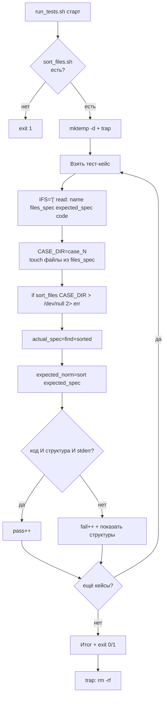

# Задача 10. Тестирование сортировщика файлов

## 10.1. Входные и выходные данные

### Скрипт под тестом: `sort_files.sh`

| Параметр | Описание |
| :--- | :--- |
| **Вход** | Один аргумент — путь к директории |
| **Выход (STDOUT)** | `OK` — успех, `ERROR` — ошибка (в `stderr`) |
| **Код возврата** | `0` — файлы разложены, `1` — ошибка входных данных |
| **Побочный эффект** | Создаёт поддиректории и перемещает файлы |

**Правило раскладки:**
- Файлы с расширением `.txt` → поддиректория `txt/`.
- Файлы с расширением `.log` → поддиректория `log/`.
- Файлы с расширением `.jpg` → поддиректория `jpg/`.
- Файлы без расширения → поддиректория `noext/`.
- Остальные расширения → поддиректория `other/`.

**Правила валидности:**
- Ровно один аргумент.
- Аргумент — существующая директория.
- Директория доступна для записи.

**Важно:** скрипт **перемещает** файлы (`mv`), а не копирует. После запуска файлы должны быть в поддиректориях. Это важное отличие от задачи 6 (там создавался новый файл, здесь изменяется существующая структура).

### Раннер: `run_tests.sh`

| Параметр | Описание |
| :--- | :--- |
| **Вход** | Нет аргументов |
| **Выход (STDOUT)** | `PASS:` / `FAIL:` + итог |
| **Код возврата** | `0` — все прошли, `1` — есть провалы |

**Особенность:** проверка — не вывод, а **состояние файловой системы**. Раннер для каждого теста создаёт свою директорию с файлами, запускает `sort_files.sh` и проверяет, что структура каталогов после запуска соответствует ожидаемой.

**Ключевое решение:** для каждого теста — своя директория. Иначе тесты перезапишут друг друга, и результат будет непредсказуемым.

**Как проверять структуру:** `find "$DIR" -type f | sort` даёт список всех файлов с путями. Его можно сравнить с эталонным списком через `diff <(...) <(...)`.

---

## 10.2. Пошаговое создание `sort_files.sh`

### Шаг 1. Шебанг и строгий режим

`#!/bin/bash` и `set -euo pipefail`.

**Рамочно:**
```bash
#!/bin/bash
set -euo pipefail
```

### Шаг 2. Проверить количество аргументов

Если `$# -ne 1` — `Usage` в `stderr`, `exit 1`.

**Рамочно:**
```bash
if [ $# -ne 1 ]; then ... fi
```

### Шаг 3. Захватить директорию

`DIR="$1"`.

### Шаг 4. Проверить, что директория существует

Если `[ ! -d "$DIR" ]` — `ERROR` в `stderr`, `exit 1`.

**Рамочно:**
```bash
if [ ! -d "$DIR" ]; then ... fi
```

### Шаг 5. Проверить, что директория доступна для записи

Если `[ ! -w "$DIR" ]` — `ERROR`, `exit 1`. Без записи `mv` и `mkdir` упадут.

**Рамочно:**
```bash
if [ ! -w "$DIR" ]; then ... fi
```

### Шаг 6. Создать поддиректории

```bash
mkdir -p "$DIR/txt" "$DIR/log" "$DIR/jpg" "$DIR/noext" "$DIR/other"
```

**Почему `-p`:** не ругается, если директория уже есть. Скрипт идемпотентен — можно запускать повторно.

**Почему все поддиректории сразу:** даже если файлов определённого типа нет, пустая поддиректория не мешает и делает структуру предсказуемой.

### Шаг 7. Пройтись по файлам в директории

Используем `find` с `-maxdepth 1 -type f` — только файлы в корне `$DIR`, не в поддиректориях:

```bash
find "$DIR" -maxdepth 1 -type f -print0 | while IFS= read -r -d '' file; do
    ...
done
```

**Разбор:**
- `-maxdepth 1` — не заходить в поддиректории (иначе `mv` переместит и уже перемещённые файлы).
- `-type f` — только файлы.
- `-print0` + `read -r -d ''` — безопасная обработка имён с пробелами и переводами строк.
- `while` в конвейере — работает в subshell, но это нормально: мы не меняем переменные снаружи.

**Важно:** `while` в пайпе работает в подоболочке. Если бы мы хотели считать файлы снаружи, счётчик не обновился бы. Но для `sort_files.sh` счётчик не нужен.

### Шаг 8. Определить расширение

Внутри цикла:

```bash
ext="${file##*.}"
```

**Разбор:**
- `${file##*.}` — удалить всё до последней точки включительно. Для `file.tar.gz` вернёт `gz`. Для `file` (без точки) вернёт само `file`.

**Проблема:** для файла без расширения `${file##*.}` вернёт имя файла целиком. Нужно отличить «расширение» от «имени файла».

**Решение:**
```bash
base=$(basename "$file")
if [[ "$base" == *.* ]]; then
    ext="${base##*.}"
else
    ext=""
fi
```

**Разбор:**
- `basename "$file"` — имя файла без пути.
- `[[ "$base" == *.* ]]` — есть ли точка в имени.
- Если есть — берём всё после последней точки. Если нет — `ext=""`.

**Почему `basename`, а не `$file`:** путь `$file` содержит `/`, и `${file##*.}` на `/tmp/dir/file` без точки вернёт `file` — а это не расширение. Нужно работать с именем файла.

### Шаг 9. Выбрать поддиректорию по расширению

```bash
case "$ext" in
    txt)   dest="$DIR/txt" ;;
    log)   dest="$DIR/log" ;;
    jpg)   dest="$DIR/jpg" ;;
    "")    dest="$DIR/noext" ;;
    *)     dest="$DIR/other" ;;
esac
```

**Разбор:**
- `txt)`, `log)`, `jpg)` — точное совпадение расширения.
- `"")` — файл без расширения.
- `*)` — всё остальное.

**Почему `case`, а не `if/elif`:** шесть ветвей — `case` читается лучше.

### Шаг 10. Переместить файл

```bash
mv "$file" "$dest/"
```

**Важно:** `mv`, а не `cp`. Задача — **разложить** файлы, а не скопировать.

**Подводный камень:** если в `$dest/` уже есть файл с тем же именем — `mv` перезапишет его без предупреждения. В реальной задаче стоило бы проверять коллизии. Но для тренировки оставляем простое поведение — и упоминаем это в комментарии.

### Шаг 11. Вывести результат и код

После цикла — `echo "OK"` и `exit 0`.

**Важно:** `echo "OK"` пишется один раз в конце, а не на каждый файл. Это делает вывод предсказуемым для раннера.

### Шаг 12. Сделать исполняемым и проверить вручную

`chmod +x sort_files.sh`. Создайте тестовую директорию:
```bash
mkdir -p /tmp/sorttest
cd /tmp/sorttest
touch a.txt b.log c.jpg noext d.pdf
```

Прогоните:
```bash
/tmp/sort_files.sh /tmp/sorttest
# OK
find /tmp/sorttest -type f | sort
# /tmp/sorttest/jpg/c.jpg
# /tmp/sorttest/log/b.log
# /tmp/sorttest/noext/noext
# /tmp/sorttest/other/d.pdf
# /tmp/sorttest/txt/a.txt
```

Проверьте ошибочные случаи:
```bash
/tmp/sort_files.sh /tmp/nope     # ERROR, код 1
/tmp/sort_files.sh                # Usage, код 1
```

---

## 10.3. Пошаговое создание `run_tests.sh`

### Шаг 1. Шебанг и строгий режим

`#!/bin/bash` и `set -euo pipefail`.

### Шаг 2. Определить путь к целевому скрипту

`TARGET="./sort_files.sh"`.

### Шаг 3. Проверить, что целевой скрипт существует и исполняем

`[[ -x "$TARGET" ]] || { echo "..." >&2; exit 1; }`.

### Шаг 4. Создать временную директорию и `trap`

```bash
TEST_DIR=$(mktemp -d)
trap 'rm -rf "$TEST_DIR"' EXIT
```

**Зачем:** каждый тест создаёт свою поддиректорию в `$TEST_DIR`. `trap` уберёт всё при выходе.

### Шаг 5. Объявить массив тест-кейсов

Формат: `"имя_теста|описание_файлов|ожидаемая_структура|ожидаемый_код"`. Четыре поля, каждое — своя мини-спецификация.

**Проблема:** описание файлов и ожидаемая структура — это списки, которые не помещаются в одну строку без разделителей.

**Решение:** использовать `;` как разделитель элементов внутри поля. Итоговый формат:
```
"имя|файл1;файл2;файл3|путь1;путь2;путь3|код"
```

Примеры:
- `'basic|a.txt;b.log;c.jpg;d.pdf;noext|txt/a.txt;log/b.log;jpg/c.jpg;other/d.pdf;noext/noext|0'` — все типы
- `'empty|||0'` — пустая директория
- `'only_txt|a.txt;b.txt|txt/a.txt;txt/b.txt|0'` — только txt
- `'only_noext|readme;license|noext/readme;noext/license|0'` — только без расширения
- `'mixed_case|A.TXT;b.TxT|other/A.TXT;other/b.TxT|0'` — регистр имеет значение (упрощение)

**Важно про регистр:** наш `sort_files.sh` использует `case "$ext"` с точным совпадением. `A.TXT` попадёт в `other/`, а не в `txt/`. Это документированное поведение — и тест его фиксирует. Если хотите регистронезависимость — добавьте `ext="${ext,,}"` перед `case`.

**Про пустую директорию:** кейс `'empty|||0'` — три пустых поля между `|`. При разборе через `IFS='|' read` все три переменные получат пустые строки. Обработка: пустой список файлов → не создавать файлы; пустая ожидаемая структура → не с чем сравнивать (проверяем, что `find` возвращает пусто).

**Рамочно:**
```bash
TESTS=(
    'basic|a.txt;b.log;c.jpg;d.pdf;noext|txt/a.txt;log/b.log;jpg/c.jpg;other/d.pdf;noext/noext|0'
    'empty|||0'
    ...
)
```

### Шаг 6. Завести счётчики и номер теста

`pass=0`, `fail=0`, `n=0`.

### Шаг 7. Цикл по тест-кейсам

```bash
for t in "${TESTS[@]}"; do
    IFS='|' read -r name files_spec expected_spec expected_code <<< "$t"
    n=$((n + 1))
    ...
done
```

**Четыре переменные:** `name`, `files_spec`, `expected_spec`, `expected_code`.

### Шаг 8. Создать директорию для теста и наполнить её

```bash
CASE_DIR="$TEST_DIR/case_${n}"
mkdir -p "$CASE_DIR"

IFS=';' read -ra FILES <<< "$files_spec"
for f in "${FILES[@]}"; do
    [ -z "$f" ] && continue
    touch "$CASE_DIR/$f"
done
```

**Разбор:**
- `mkdir -p` — создать директорию для конкретного теста.
- `IFS=';' read -ra FILES` — разбить спецификацию по `;` в массив. `-a` — массив, `-r` — не интерпретировать `\`.
- `[ -z "$f" ] && continue` — пропустить пустые элементы (для кейса `empty`).
- `touch` — создать пустой файл. Имя файла может содержать подпуть (`sub/a.txt`) — но в наших кейсах без подпутей. Для простоты.

**Почему не `mkdir -p "$(dirname ...)"`:** если файл `sub/a.txt`, `touch` упадёт без директории. Но в тест-кейсах путей с подкаталогами нет — фиксируем это как упрощение.

### Шаг 9. Запустить целевой скрипт

```bash
if "$TARGET" "$CASE_DIR" > /dev/null 2> "$TEST_DIR/err_${n}.txt"; then
    actual_code=0
else
    actual_code=$?
fi
```

**Разбор:**
- `> /dev/null` — STDOUT не нужен, только структура.
- `2> err_${n}.txt` — STDERR сохраняем, чтобы проверить наличие сообщения при ошибке.
- `if command; then ... else ... fi` — не прерывает скрипт под `set -e`, позволяет захватить код.

### Шаг 10. Построить фактическую структуру

```bash
actual_spec=$(cd "$CASE_DIR" && find . -type f | sed 's|^\./||' | sort | tr '\n' ';' | sed 's/;$//')
```

**Разбор по частям:**
- `cd "$CASE_DIR"` — зайти в директорию теста, чтобы пути были относительные.
- `find . -type f` — все файлы, включая перемещённые в поддиректории.
- `sed 's|^\./||'` — убрать префикс `./` (иначе пути будут `./txt/a.txt`).
- `sort` — упорядочить, чтобы сравнение было стабильным.
- `tr '\n' ';'` — склеить строки в одну через `;`.
- `sed 's/;$//'` — убрать последний `;`.

**Результат:** строка вида `jpg/c.jpg;log/b.log;noext/noext;other/d.pdf;txt/a.txt`.

**Почему в subshell `(cd ... && ...)`:** смена директории не влияет на основной скрипт. Это стандартный приём для работы с относительными путями.

**Проблема:** `actual_spec` может содержать символы `;`, если в имени файла есть `;`. Для наших тестов это не проблема, но в реальности — используйте другой разделитель (например, `\0`).

### Шаг 11. Нормализовать ожидаемую структуру

```bash
expected_norm=$(echo "$expected_spec" | tr ';' '\n' | sort | tr '\n' ';' | sed 's/;$//')
```

**Зачем:** ожидаемая строка в тест-кейсе записана в произвольном порядке (`txt/a.txt;log/b.log;...`). Фактическая — отсортирована. Чтобы сравнение работало, обе нужно привести к одному порядку.

**Разбор:**
- `tr ';' '\n'` — разбить на строки.
- `sort` — отсортировать.
- `tr '\n' ';'` — склеить обратно.
- `sed 's/;$//'` — убрать последний `;`.

**Для кейса `empty`:** `expected_spec=""` → `expected_norm=""`. `actual_spec` тоже пустой. Совпадают.

### Шаг 12. Сравнить

```bash
if [ "$actual_code" -eq "$expected_code" ] \
   && [ "$actual_spec" = "$expected_norm" ] \
   && { [ "$expected_code" -eq 0 ] || [ -s "$TEST_DIR/err_${n}.txt" ]; }; then
    echo "PASS: $name"
    pass=$((pass + 1))
else
    echo "FAIL: $name"
    echo "  код: ожидался $expected_code, получен $actual_code"
    echo "  структура:"
    echo "    ожидалась: $expected_norm"
    echo "    получена:  $actual_spec"
    fail=$((fail + 1))
fi
```

**Разбор трёх условий:**
1. Код возврата совпал.
2. Структура файлов совпала (после нормализации).
3. Для успешных кейсов STDERR не важен; для ошибочных — должен быть не пустым.

**Почему структура важнее вывода:** задача `sort_files.sh` — изменить файловую систему. Вывод `OK` — вторичен. Если структура неверна, `OK` не имеет значения.

**Почему `diff` не используем:** `diff` работает с файлами, а у нас — строки в переменных. Строковое сравнение `=` корректно после нормализации. Для сложных случаев можно использовать `diff <(echo "$expected_norm") <(echo "$actual_spec")` — но это лишний оверхед.

**Важно:** `pass=$((pass + 1))`, а не `((pass++))`.

### Шаг 13. Итоговая сводка и код возврата

```bash
echo "Итого: PASS=$pass, FAIL=$fail"
[[ $fail -eq 0 ]] || exit 1
```

**Очистка** — через `trap` на шаге 4.

### Шаг 14. Сделать исполняемым и запустить

`chmod +x run_tests.sh`. Запустите `./run_tests.sh`. Затем специально сломайте `sort_files.sh` (например, уберите ветку `"")` — файлы без расширения уйдут в `other/`) и убедитесь, что раннер поймал регрессию.

---

## 10.4. Схема работы



---

# Сравнение задач 9 и 10

| Аспект | Задача 9 (CSV) | Задача 10 (сортировщик) |
| :--- | :--- | :--- |
| Сложность валидации | Средняя (файл, колонка) | Низкая (директория) |
| Что проверяет раннер | Вывод (строки) + код + stderr | Структура файловой системы + код + stderr |
| Формат тест-кейса | `файл\|колонка\|значение\|expect_file\|код` | `имя\|файлы\|ожидаемая_структура\|код` |
| Подводный камень | Многострочный вывод → `diff` с файлами | Изоляция директорий + нормализация порядка |
| Изоляция | Свои CSV-файлы для граничных случаев | Своя директория для каждого теста |
| Побочный эффект | Нет (только вывод) | Да (`mv`, `mkdir`) |
| Что тренирует | `awk`, `diff`, работа с файлами | `find -print0`, `case`, `cd` в subshell, нормализация |

---

# Чек-лист для задач

- [ ] Целевой скрипт проверяет число аргументов и выводит `Usage` при ошибке.
- [ ] Целевой скрипт возвращает разные коды для успеха и провала.
- [ ] Целевой скрипт пишет ошибки в `stderr`, результат — в FS.
- [ ] Раннер проверяет существование и исполняемость целевого скрипта.
- [ ] Раннер хранит тест-кейсы в массиве.
- [ ] Раннер захватывает вывод, stderr и код возврата.
- [ ] Раннер сравнивает все три.
- [ ] Раннер считает `pass`/`fail` через `$((...))`, а не `((++))`.
- [ ] Раннер возвращает `exit 1` при наличии провалов.
- [ ] Каждый тест использует свою директорию.
- [ ] Используется `find -print0 | while read -d ''` — иначе имена с пробелами сломаются.
- [ ] Порядок файлов нормализуется через `sort` перед сравнением.
- [ ] Оба скрипта проверены через `bash -n`.
- [ ] Оба скрипта запущены вручную и показали ожидаемый результат.
- [ ] Регрессия (специально внесённая ошибка) поймана раннером.