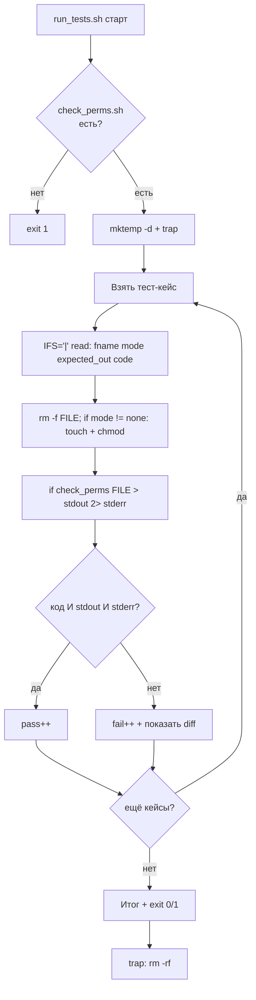

# Задачи 11 и 12: пошаговые инструкции

---

# Задача 11. Тестирование проверки прав доступа

## 11.1. Входные и выходные данные

### Скрипт под тестом: `check_perms.sh`

| Параметр | Описание |
| :--- | :--- |
| **Вход** | Один аргумент — путь к файлу |
| **Выход (STDOUT)** | Три символа прав владельца: `rwx`, `rw-`, `r--`, `---` и т.д. |
| **Код возврата** | `0` — права получены, `1` — файла нет или неверное число аргументов |
| **STDERR** | Сообщение об ошибке при неверных входных данных |

**Правила валидности:**
- Ровно один аргумент.
- Файл существует.

**Важно:** выводим только **права владельца** (первые 3 символа после типа), а не полную строку `rwxr-xr-x`. Это делает задачу узкой и проверяемой.

**Как получить права:** `stat -c '%A' "$FILE"` даёт 10-символьную строку: тип + 3 группы по 3. Например, `-rwxr-xr-x`. Права владельца — символы с индекса 1 по 3 включительно: `rwx`.

**Подводный камень:** `stat` не требует права на чтение файла — только права на обход родительской директории. Поэтому файл с правами `000` можно прочитать через `stat`, хотя `cat` на нём упадёт.

### Раннер: `run_tests.sh`

| Параметр | Описание |
| :--- | :--- |
| **Вход** | Нет аргументов |
| **Выход (STDOUT)** | `PASS:` / `FAIL:` + итог |
| **Код возврата** | `0` — все прошли, `1` — есть провалы |

**Особенность:** раннер сам создаёт файлы с нужными правами через `chmod`. Формат тест-кейса: `"имя_файла|режим|ожидаемый_вывод|ожидаемый_код"`. Для теста «файла нет» используем специальное значение режима `none` — файл не создаётся.

**Критично:** ошибки (`ERROR`) пишутся в `stderr`, а не в `stdout`. Поэтому для ошибочных кейсов `expected_out=""` (пусто), а проверяется, что `stderr` не пустой.

---

## 11.2. Пошаговое создание `check_perms.sh`

### Шаг 1. Шебанг и строгий режим

`#!/bin/bash` и `set -euo pipefail`.

**Рамочно:**
```bash
#!/bin/bash
set -euo pipefail
```

### Шаг 2. Проверить количество аргументов

Если `$# -ne 1` — вывести `Usage` в `stderr` и `exit 1`.

**Рамочно:**
```bash
if [ $# -ne 1 ]; then ... fi
```

### Шаг 3. Захватить путь к файлу

`FILE="$1"`.

### Шаг 4. Проверить, что файл существует

Если `[ ! -e "$FILE" ]` — вывести `ERROR` в `stderr` и `exit 1`.

**Рамочно:**
```bash
if [ ! -e "$FILE" ]; then ... fi
```

**Почему `-e`, а не `-f`:** `-e` проверяет существование любого объекта (файл, директория, симлинк). `-f` — только регулярный файл. Для теста с файлами разницы нет, но `-e` универсальнее.

**Почему не проверяем `-r`:** `stat` работает без права чтения содержимого. Достаточно существования и прав на родительскую директорию.

### Шаг 5. Получить полную строку прав через `stat`

```bash
perms=$(stat -c '%A' "$FILE")
```

**Разбор:**
- `-c '%A'` — GNU-синтаксис: вывести строку прав в символьно-буквенном виде.
- Результат: 10 символов, например `-rwxr-xr-x`.
- Первый символ — тип (`-` файл, `d` директория, `l` симлинк), остальные 9 — три группы `rwx`.

**Важно:** на BSD/macOS синтаксис другой (`stat -f '%Sp'`). Мы ориентируемся на Linux.

**Что если `stat` упадёт?** Под `set -e` скрипт прервётся. Но мы уже проверили `-e`, так что `stat` не должен упасть. Если упадёт — это сбой системы, и падение с ошибкой — правильное поведение.

### Шаг 6. Извлечь права владельца

```bash
owner_perms="${perms:1:3}"
```

**Разбор:**
- `${perms:1:3}` — подстрока с индекса 1 длиной 3 символа.
- Индексация с 0: символ 0 — тип, символы 1–3 — права владельца.
- Для `-rwxr-xr-x` → `rwx`.

**Почему не `cut -c2-4`:** `cut` запускает отдельный процесс. `${var:offset:len}` — встроенная подстановка Bash, работает без форка. Быстрее.

### Шаг 7. Вывести результат и код

`echo "$owner_perms"` и `exit 0`.

### Шаг 8. Сделать исполняемым и проверить вручную

`chmod +x check_perms.sh`. Прогоните:
```bash
touch /tmp/f_test
chmod 755 /tmp/f_test && ./check_perms.sh /tmp/f_test   # rwx
chmod 644 /tmp/f_test && ./check_perms.sh /tmp/f_test   # rw-
chmod 600 /tmp/f_test && ./check_perms.sh /tmp/f_test   # rw-
chmod 700 /tmp/f_test && ./check_perms.sh /tmp/f_test   # rwx
chmod 444 /tmp/f_test && ./check_perms.sh /tmp/f_test   # r--
chmod 000 /tmp/f_test && ./check_perms.sh /tmp/f_test   # ---
./check_perms.sh /tmp/nope                              # ERROR, код 1
./check_perms.sh                                        # Usage, код 1
```

---

## 11.3. Пошаговое создание `run_tests.sh`

### Шаг 1. Шебанг и строгий режим

`#!/bin/bash` и `set -euo pipefail`.

### Шаг 2. Определить путь к целевому скрипту

`TARGET="./check_perms.sh"`.

### Шаг 3. Проверить, что целевой скрипт существует и исполняем

`[[ -x "$TARGET" ]] || { echo "..." >&2; exit 1; }`.

### Шаг 4. Создать временную директорию и `trap`

```bash
TEST_DIR=$(mktemp -d)
trap 'rm -rf "$TEST_DIR"' EXIT
```

**Зачем:** все тестовые файлы создаются в `$TEST_DIR`. `trap` уберёт их при любом исходе.

### Шаг 5. Объявить массив тест-кейсов

Формат: `"имя_файла|режим|ожидаемый_вывод|ожидаемый_код"`.

Примеры:
- `"f755.txt|755|rwx|0"` — полный доступ владельца
- `"f644.txt|644|rw-|0"` — стандартный конфиг
- `"f600.txt|600|rw-|0"` — приватный файл
- `"f700.txt|700|rwx|0"` — только владелец
- `"f444.txt|444|r--|0"` — только чтение
- `"f000.txt|000|---|0"` — нет прав
- `"no_file.txt|none||1"` — файла нет, вывод пустой, код 1

**Почему для `000` ожидаем `---`:** `stat` не требует чтения содержимого, поэтому сработает даже на файле без прав. Ожидаемый вывод — три дефиса.

**Почему для `no_file.txt` режим `none`:** специальный маркер, чтобы раннер не создавал файл. Иначе `chmod none` упадёт.

**Рамочно:**
```bash
TESTS=(
    "f755.txt|755|rwx|0"
    "no_file.txt|none||1"
    ...
)
```

### Шаг 6. Завести счётчики

`pass=0`, `fail=0`.

### Шаг 7. Цикл по тест-кейсам

```bash
for t in "${TESTS[@]}"; do
    IFS='|' read -r fname mode expected_out expected_code <<< "$t"
    ...
done
```

**Четыре переменные:** `fname`, `mode`, `expected_out`, `expected_code`.

### Шаг 8. Подготовить файл с нужными правами

```bash
FILE="$TEST_DIR/$fname"
rm -f "$FILE"
if [ "$mode" != "none" ]; then
    touch "$FILE"
    chmod "$mode" "$FILE"
fi
```

**Разбор:**
- `rm -f "$FILE"` — гарантировать отсутствие файла от предыдущего запуска.
- Если режим `none` — файл не создаём (для теста «файла нет»).
- Иначе — создаём и ставим нужные права.

**Почему `rm -f` перед `touch`:** если файл остался от предыдущей итерации (не должен, но на всякий), `chmod` сработает на старых правах, а `touch` не сбросит их.

**Подводный камень:** `chmod 000` на файле, который вы создали сами — можно. Но потом `rm` на нём тоже можно, потому что `rm` требует только прав на директорию, а не на файл.

### Шаг 9. Вызвать целевой скрипт и захватить вывод и код

```bash
actual_out_file="$TEST_DIR/stdout_$fname"
actual_err_file="$TEST_DIR/stderr_$fname"
if "$TARGET" "$FILE" > "$actual_out_file" 2> "$actual_err_file"; then
    actual_code=0
else
    actual_code=$?
fi
```

**Разбор:**
- Разделяем STDOUT и STDERR на разные файлы.
- `if command; then … else … fi` — не прерывает скрипт под `set -e`, позволяет захватить код.
- `$actual_code` — код возврата (0 или 1).

### Шаг 10. Сравнить вывод, ошибку и код

```bash
actual_out=$(cat "$actual_out_file")
if [ "$actual_code" -eq "$expected_code" ] \
   && [ "$actual_out" = "$expected_out" ] \
   && { [ "$expected_code" -eq 0 ] || [ -s "$actual_err_file" ]; }; then
    echo "PASS: $t"
    pass=$((pass + 1))
else
    echo "FAIL: $t"
    echo "  код: ожидался $expected_code, получен $actual_code"
    echo "  вывод: ожидался '$expected_out', получен '$actual_out'"
    fail=$((fail + 1))
fi
```

**Разбор трёх условий:**
1. Код возврата совпал.
2. STDOUT совпал с ожидаемым (строковое сравнение, вывод в одну строку — нормально).
3. Для ошибочных кейсов — STDERR не пустой (скрипт объяснил проблему).

**Почему `=`, а не `==`:** в `[ ]` (POSIX test) используется `=`, в `[[ ]]` — `==`. Мы внутри `[ ]`, поэтому `=`. Обе формы работают в `[ ]` в Bash, но `=` — каноничнее.

**Важно:** `pass=$((pass + 1))`, а не `((pass++))`.

### Шаг 11. Итоговая сводка и код возврата

```bash
echo "Итого: PASS=$pass, FAIL=$fail"
[[ $fail -eq 0 ]] || exit 1
```

### Шаг 12. Сделать исполняемым и запустить

`chmod +x run_tests.sh`. Запустите `./run_tests.sh`. Затем специально сломайте `check_perms.sh` (например, замените `${perms:1:3}` на `${perms:1:9}` — вывод станет 9-символьным) и убедитесь, что раннер поймал регрессию.

---

## 11.4. Схема работы



---


# Чек-лист для задач

- [ ] Целевой скрипт проверяет число аргументов и выводит `Usage` в `stderr` при ошибке.
- [ ] Целевой скрипт возвращает разные коды для успеха и провала.
- [ ] Целевой скрипт пишет ошибки в `stderr`, результат — в `stdout`.
- [ ] Раннер проверяет существование и исполняемость целевого скрипта.
- [ ] Раннер хранит тест-кейсы в массиве.
- [ ] Раннер захватывает `stdout`, `stderr` и код возврата.
- [ ] Раннер сравнивает все три.
- [ ] Раннер считает `pass`/`fail` через `$((...))`, а не `((++))`.
- [ ] Раннер возвращает `exit 1` при наличии провалов.
- [ ] Файлы создаются в `$TEST_DIR` и очищаются через `trap`.
- [ ] Специальный режим `none` — файл не создаётся.
- [ ] Оба скрипта проверены через `bash -n`.
- [ ] Оба скрипта запущены вручную и показали ожидаемый результат.
- [ ] Регрессия (специально внесённая ошибка) поймана раннером.