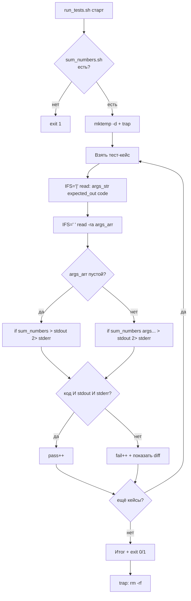

# Задача 12. Тестирование сумматора чисел

## 12.1. Входные и выходные данные

### Скрипт под тестом: `sum_numbers.sh`

| Параметр | Описание |
| :--- | :--- |
| **Вход** | Один или более аргументов — числа (целые или дробные, возможно отрицательные) |
| **Выход (STDOUT)** | Сумма всех чисел |
| **Код возврата** | `0` — сумма посчитана, `1` — нет аргументов или нечисловой аргумент |
| **STDERR** | Сообщение об ошибке при неверных входных данных |

**Правила валидности:**
- Минимум один аргумент.
- Каждый аргумент соответствует регулярке `^-?[0-9]+(\.[0-9]+)?$`:
  - необязательный минус;
  - цифры;
  - необязательная точка и цифры после неё.
- `+5`, `.5`, `5.`, `1e10`, `abc` — **невалидны**.

**Формат вывода:** используем `awk` с `print sum` (не `printf "%.2f"`). Тогда:
- Сумма целых → целое (`10`, `0`, `-10`).
- Сумма с дробями → число с нужной точностью (`10.5`, `0.3`).

Это естественнее, чем всегда печатать `.00`. Раннер должен учитывать, что `5 5` даёт `10`, а не `10.00`.

**Почему не `bc`:** `bc` на некоторых системах печатает `.3` вместо `0.3`. `awk` ведёт себя предсказуемее.

### Раннер: `run_tests.sh`

| Параметр | Описание |
| :--- | :--- |
| **Вход** | Нет аргументов |
| **Выход (STDOUT)** | `PASS:` / `FAIL:` + итог |
| **Код возврата** | `0` — все прошли, `1` — есть провалы |

**Особенность:** аргументы для теста — это список чисел через пробел. При формате `"args|expected|code"` поле `args` содержит пробелы. `IFS='|' read` прочитает строку целиком, а затем нужно **вторым** `read` разбить `args` на массив.

**Критично:** пустой список аргументов. Для кейса «нет аргументов» поле `args` пустое. Нужно вызвать `"$TARGET"` без аргументов вообще, а не с одним пустым.

---

## 12.2. Пошаговое создание `sum_numbers.sh`

### Шаг 1. Шебанг и строгий режим

`#!/bin/bash` и `set -euo pipefail`.

**Рамочно:**
```bash
#!/bin/bash
set -euo pipefail
```

### Шаг 2. Проверить, что аргументы есть

Если `$# -lt 1` — вывести `Usage` в `stderr` и `exit 1`.

**Рамочно:**
```bash
if [ $# -lt 1 ]; then ... fi
```

**Почему `-lt 1`, а не `-eq 0`:** эквивалентно, но `-lt 1` читается как «меньше одного» — точнее отражает смысл.

### Шаг 3. Проверить каждый аргумент на числовой формат

```bash
for arg in "$@"; do
    if [[ ! "$arg" =~ ^-?[0-9]+(\.[0-9]+)?$ ]]; then
        echo "ERROR: invalid number '$arg'" >&2
        exit 1
    fi
done
```

**Разбор:**
- `"$@"` — все позиционные аргументы как отдельные строки.
- `[[ =~ ]]` — регулярка Bash.
- `^-?` — необязательный минус.
- `[0-9]+` — одна или более цифр.
- `(\.[0-9]+)?` — необязательная дробная часть.

**Почему проверяем в цикле:** `awk` упадёт или вернёт мусор на нечисловом аргументе. Лучше отловить заранее и выдать понятную ошибку с указанием проблемного аргумента.

**Важно:** проверка идёт до суммирования. Если в списке `1 abc 3`, ошибка будет на `abc`, и сумма не будет считаться вовсе.

### Шаг 4. Вычислить сумму через `awk`

```bash
printf '%s\n' "$@" | awk '{ sum += $1 } END { print sum }'
```

**Разбор:**
- `printf '%s\n' "$@"` — вывести каждый аргумент на отдельной строке. Получаем входной поток: `5\n5\n`.
- `awk '{ sum += $1 }'` — накапливать первое поле (оно единственное).
- `END { print sum }` — после всех строк напечатать сумму.
- `print sum` — `awk` сам решит, печатать `10` или `10.5`, в зависимости от результата.

**Почему `printf '%s\n'` без `--`:** аргументы уже прошли валидацию на регулярку. Начинаться с `-` могут только отрицательные числа (`-5`), и `printf` их обработает как строку, не как опцию. Если бы мы не валидировали раньше, был бы риск `printf -- "-5\n"`.

**Почему не `echo`:** `echo` интерпретирует `-e`, `-n` и прочее. `printf '%s\n'` предсказуем.

### Шаг 5. Сделать исполняемым и проверить вручную

`chmod +x sum_numbers.sh`. Прогоните:
```bash
./sum_numbers.sh 5 5          # 10
./sum_numbers.sh 1 2 3 4 5    # 15
./sum_numbers.sh 5.5 4.5      # 10
./sum_numbers.sh 5 -3         # 2
./sum_numbers.sh 0            # 0
./sum_numbers.sh -5 -5        # -10
./sum_numbers.sh 100 200 300  # 600
./sum_numbers.sh abc          # ERROR, код 1
./sum_numbers.sh 1 abc 3      # ERROR, код 1
./sum_numbers.sh              # Usage, код 1
./sum_numbers.sh 1.2.3        # ERROR, код 1
```

**Обратите внимание:** `./sum_numbers.sh 5 5` печатает `10`, а не `10.00`. Это ожидаемое поведение — раннер должен это учитывать.

---

## 12.3. Пошаговое создание `run_tests.sh`

### Шаг 1. Шебанг и строгий режим

`#!/bin/bash` и `set -euo pipefail`.

### Шаг 2. Определить путь к целевому скрипту

`TARGET="./sum_numbers.sh"`.

### Шаг 3. Проверить, что целевой скрипт существует и исполняем

`[[ -x "$TARGET" ]] || { echo "..." >&2; exit 1; }`.

### Шаг 4. Создать временную директорию и `trap`

```bash
TEST_DIR=$(mktemp -d)
trap 'rm -rf "$TEST_DIR"' EXIT
```

**Зачем:** для сохранения STDOUT и STDERR каждого теста на диск — это позволяет сравнивать их через `diff` без хрупких конструкций в памяти. `trap` очищает.

### Шаг 5. Объявить массив тест-кейсов

Формат: `"аргументы|ожидаемый_вывод|ожидаемый_код"`. Аргументы — числа через пробел.

Примеры:
- `"5 5|10|0"` — два целых
- `"1 2 3 4 5|15|0"` — пять целых
- `"5.5 4.5|10|0"` — дробные, сумма целая
- `"5 -3|2|0"` — смешанные знаки
- `"0|0|0"` — ноль
- `"-5 -5|-10|0"` — отрицательные
- `"100 200 300|600|0"` — три числа
- `"1.5 2.5 3|7|0"` — смешанные
- `"abc||1"` — нечисловой, вывод пустой
- `"1 abc 3||1"` — один нечисловой в середине
- `"1.2.3||1"` — неверный формат
- `"||1"` — нет аргументов (поле args пустое)

**Обратите внимание на пустое поле args:** `"||1"` разбирается как args="", expected="", code="1".

**Рамочно:**
```bash
TESTS=(
    "5 5|10|0"
    "abc||1"
    ...
)
```

### Шаг 6. Завести счётчики

`pass=0`, `fail=0`.

### Шаг 7. Цикл по тест-кейсам

```bash
for t in "${TESTS[@]}"; do
    IFS='|' read -r args_str expected_out expected_code <<< "$t"
    ...
done
```

**Три переменные:** `args_str`, `expected_out`, `expected_code`.

### Шаг 8. Разбить строку аргументов на массив

```bash
IFS=' ' read -ra args_arr <<< "$args_str"
```

**Разбор:**
- `IFS=' '` — разделитель — пробел.
- `-ra` — `-r` (не интерпретировать `\`) и `-a` (в массив).
- `<<< "$args_str"` — передать строку на STDIN `read`.
- Результат: `args_arr=("5" "5")` для `args_str="5 5"`.

**Для пустой строки:** `IFS=' ' read -ra args_arr <<< ""` → `args_arr=()` (пустой массив).

**Почему не `$args_str` без кавычек:** `$args_str` без кавычек разобьётся по `IFS`, но текущий `IFS` — `'|'` от предыдущего `read`. Нужно явно `IFS=' '`.

**Почему два отдельных `read`:** первый разбирает тест-кейс по `|`, второй — аргументы по пробелу. Это разные разделители, поэтому и два вызова.

### Шаг 9. Вызвать целевой скрипт с правильным числом аргументов

```bash
actual_out_file="$TEST_DIR/stdout_${RANDOM}.txt"
actual_err_file="$TEST_DIR/stderr_${RANDOM}.txt"
if [ ${#args_arr[@]} -gt 0 ]; then
    if "$TARGET" "${args_arr[@]}" > "$actual_out_file" 2> "$actual_err_file"; then
        actual_code=0
    else
        actual_code=$?
    fi
else
    if "$TARGET" > "$actual_out_file" 2> "$actual_err_file"; then
        actual_code=0
    else
        actual_code=$?
    fi
fi
```

**Разбор:**
- `[ ${#args_arr[@]} -gt 0 ]` — есть ли аргументы.
- `"${args_arr[@]}"` — передать массив как отдельные аргументы. На Bash 4.4+ пустой массив под `set -u` не падает, но мы всё равно проверяем явно — так безопаснее и читаемее.
- `RANDOM` в имени файла — избежать коллизий, если тестов много.

**Почему не `"${args_arr[@]:-}"`:** `${arr[@]:-}` на пустом массиве вернёт **одну пустую строку** — то есть `"$TARGET" ""`, а не `"$TARGET"`. Это не то, что нужно. Поэтому явная ветка `if`.

### Шаг 10. Сравнить вывод, ошибку и код

```bash
actual_out=$(cat "$actual_out_file")
if [ "$actual_code" -eq "$expected_code" ] \
   && [ "$actual_out" = "$expected_out" ] \
   && { [ "$expected_code" -eq 0 ] || [ -s "$actual_err_file" ]; }; then
    echo "PASS: $t"
    pass=$((pass + 1))
else
    echo "FAIL: $t"
    echo "  код: ожидался $expected_code, получен $actual_code"
    echo "  вывод: ожидался '$expected_out', получен '$actual_out'"
    if [ "$expected_code" -ne 0 ] && [ ! -s "$actual_err_file" ]; then
        echo "  stderr пуст, хотя ожидалась ошибка"
    fi
    fail=$((fail + 1))
fi
```

**Разбор трёх условий:**
1. Код возврата совпал.
2. STDOUT совпал (одна строка, строковое сравнение).
3. Для ошибочных кейсов — STDERR не пустой.

**Почему `=` и `[ ]`:** внутри `[ ]` используется `=`, это POSIX-канон. `[[ ]]` тоже работает, но `[ ]` привычнее для условий с `-eq` и флагами файлов.

**Важно:** `pass=$((pass + 1))`, а не `((pass++))`.

### Шаг 11. Итоговая сводка и код возврата

```bash
echo "Итого: PASS=$pass, FAIL=$fail"
[[ $fail -eq 0 ]] || exit 1
```

### Шаг 12. Сделать исполняемым и запустить

`chmod +x run_tests.sh`. Запустите `./run_tests.sh`. Затем специально сломайте `sum_numbers.sh` (например, уберите проверку `-lt 1` — пустой вызов вернёт `0` вместо ошибки) и убедитесь, что раннер поймал регрессию на кейсе `"||1"`.

---

## 12.4. Схема работы



---

# Сравнение задач 11 и 12

| Аспект | Задача 11 (права) | Задача 12 (сумматор) |
| :--- | :--- | :--- |
| Сложность валидации | Низкая (существование файла) | Средняя (числовой формат каждого аргумента) |
| Что проверяет раннер | STDOUT + код + stderr | STDOUT + код + stderr |
| Формат тест-кейса | `файл\|режим\|ожидаемый_вывод\|код` | `аргументы\|ожидаемый_вывод\|код` |
| Подводный камень | `chmod` в раннере; `000` и `stat` | Пустое поле args → два `read` с разными IFS |
| Побочный эффект | Создаются файлы с правами | Нет |
| Что тренирует | `stat -c '%A'`, `${var:1:3}`, `chmod` в тестах | Валидация в цикле, `printf '%s\n' \| awk`, разбиение аргументов |
| Особый случай | Режим `none` — файл не создаётся | Пустой массив аргументов — особый вызов |

---

# Чек-лист для задач

- [ ] Целевой скрипт проверяет число аргументов и выводит `Usage` в `stderr` при ошибке.
- [ ] Целевой скрипт возвращает разные коды для успеха и провала.
- [ ] Целевой скрипт пишет ошибки в `stderr`, результат — в `stdout`.
- [ ] Раннер проверяет существование и исполняемость целевого скрипта.
- [ ] Раннер хранит тест-кейсы в массиве.
- [ ] Раннер захватывает `stdout`, `stderr` и код возврата.
- [ ] Раннер сравнивает все три.
- [ ] Раннер считает `pass`/`fail` через `$((...))`, а не `((++))`.
- [ ] Раннер возвращает `exit 1` при наличии провалов.
- [ ] Строка аргументов разбивается вторым `read` с `IFS=' '`.
- [ ] Пустой массив аргументов обрабатывается отдельной веткой `if`.
- [ ] Оба скрипта проверены через `bash -n`.
- [ ] Оба скрипта запущены вручную и показали ожидаемый результат.
- [ ] Регрессия (специально внесённая ошибка) поймана раннером.