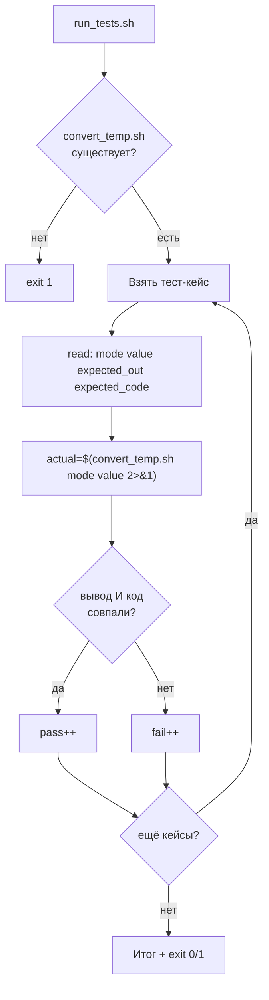

# Задача 2. Тестирование конвертера температур

## 2.1. Входные и выходные данные

### Скрипт под тестом: `convert_temp.sh`

| Параметр | Описание |
| :--- | :--- |
| **Вход** | Два аргумента: направление (`C→F` или `F→C`) и число |
| **Выход (STDOUT)** | Результат с одним знаком после запятой (например, `32.0`) |
| **Код возврата** | `0` — успех, `1` — неверное направление/число/аргументы |
| **STDERR** | Сообщение об ошибке при неверных входных данных |

**Формулы:**
- `C→F`: `F = C × 9/5 + 32`
- `F→C`: `C = (F − 32) × 5/9`

**Важно:** в Bash нет дробной арифметики. Для точности используйте `awk` или `bc`.

### Раннер: `run_tests.sh`

| Параметр | Описание |
| :--- | :--- |
| **Вход** | Нет аргументов |
| **Выход (STDOUT)** | `PASS:` / `FAIL:` по каждому кейсу + итог |
| **Код возврата** | `0` — всё прошло, `1` — есть провалы |

**Особенность:** сравнение чисел с плавающей точкой. Прямое `[[ "$a" == "$b" ]]` может не сработать из-за `32` vs `32.0`. Нужно нормализовать формат.

---

## 2.2. Пошаговое создание `convert_temp.sh`

### Шаг 1. Шебанг и строгий режим

`#!/bin/bash` и `set -euo pipefail`.

### Шаг 2. Проверить количество аргументов

Если `$# -ne 2` — вывести в `stderr` «Usage: ...» и `exit 1`.

**Рамочно:**
```bash
if [ $# -ne 2 ]; then ... fi
```

### Шаг 3. Захватить направление и значение

`MODE="$1"` и `VALUE="$2"`. Дальше работаем с переменными.

### Шаг 4. Проверить, что значение — число

Используйте регулярку `[[ "$VALUE" =~ ^-?[0-9]+(\.[0-9]+)?$ ]]`. Если не совпало — ошибка, `exit 1`. Без этой проверки `abc` попадёт в формулу и `awk` вернёт мусор.

**Рамочно:**
```bash
if [[ ! "$VALUE" =~ ^-?[0-9]+(\.[0-9]+)?$ ]]; then ... fi
```

### Шаг 5. Выполнить преобразование через `awk`

`case "$MODE"` по трём вариантам: `C→F`, `F→C`, всё остальное → ошибка.

Для `C→F`:
```bash
result=$(awk -v v="$VALUE" 'BEGIN { printf "%.1f", v * 9/5 + 32 }')
```

Для `F→C`:
```bash
result=$(awk -v v="$VALUE" 'BEGIN { printf "%.1f", (v - 32) * 5/9 }')
```

**Разбор:**
- `-v v="$VALUE"` — передать переменную Bash в `awk`.
- `BEGIN { ... }` — выполнить один раз, без чтения файла.
- `printf "%.1f"` — округлить до одного знака после запятой. Это нормализует формат: `32` станет `32.0`.

**Почему `awk`, а не `bc`:** `awk` проще для форматирования (`printf`), не требует отдельного процесса на каждое вычисление.

### Шаг 6. Вывести результат и код

`echo "$result"` и `exit 0`. При ошибке — `echo "ERROR" >&2` и `exit 1`.

**Важно:** результат всегда с одним знаком после запятой. Это критично для раннера — сравнение будет строковым.

### Шаг 7. Сделать исполняемым и проверить вручную

`chmod +x convert_temp.sh`. Прогоните:
```bash
./convert_temp.sh "C→F" 0      # 32.0
./convert_temp.sh "C→F" 100    # 212.0
./convert_temp.sh "F→C" 32     # 0.0
./convert_temp.sh "X→Y" 10     # ERROR, код 1
```

---

## 2.3. Пошаговое создание `run_tests.sh`

### Шаг 1. Шебанг и строгий режим

`#!/bin/bash` и `set -euo pipefail`.

### Шаг 2. Определить путь к целевому скрипту

`TARGET="./convert_temp.sh"`.

### Шаг 3. Проверить, что целевой скрипт существует и исполняем

`[[ -x "$TARGET" ]] || { echo "..." >&2; exit 1; }`.

### Шаг 4. Объявить массив тест-кейсов

Формат: `"направление значение ожидаемый_вывод ожидаемый_код"`. Примеры:
- `"C→F 0 32.0 0"`
- `"C→F 100 212.0 0"`
- `"C→F -40 -40.0 0"`
- `"F→C 32 0.0 0"`
- `"F→C 212 100.0 0"`
- `"X→Y 10 ERROR 1"`
- `"C→F abc ERROR 1"`
- `"C→F 36.6 97.9 0"`

**Рамочно:**
```bash
TESTS=(
    "C→F 0 32.0 0"
    ...
)
```

**Осторожно с `C→F`:** символ `→` — многобайтовый в UTF-8. В Bash он работает как обычный символ, но при копировании из документов может «поехать» кодировка. Если проблемы — замените на `C2F`/`F2C` в обоих скриптах.

### Шаг 5. Завести счётчики

`pass=0` и `fail=0`.

### Шаг 6. Цикл по тест-кейсам

`for t in "${TESTS[@]}"; do ... done`. Внутри — `read -r mode value expected_out expected_code <<< "$t"`. Четыре переменные.

**Рамочно:**
```bash
for t in "${TESTS[@]}"; do
    read -r mode value expected_out expected_code <<< "$t"
    ...
done
```

### Шаг 7. Вызвать целевой скрипт и захватить вывод и код

```bash
actual_out=$("$TARGET" "$mode" "$value" 2>/dev/null) || actual_code=$?
actual_code=${actual_code:-0}
```

**Разбор:**
- Захватываем STDOUT.
- Если скрипт упал — запоминаем код.
- Если успех — код 0.

**Важно:** для кейса `ERROR` ожидаемый вывод — `ERROR`, но `validate`-скрипт пишет его в `stderr`. Поэтому `2>/dev/null` скроет его, и `actual_out` будет пустым. Нужно либо перенаправить `2>&1` в захват, либо в раннере для кейсов с кодом 1 ожидать пустой вывод. Проще — **перенаправить `2>&1`**:

```bash
actual_out=$("$TARGET" "$mode" "$value" 2>&1) || actual_code=$?
```

Тогда `ERROR` из `stderr` попадёт в `actual_out`. Но обычные ошибки `bash` (например, «command not found») тоже попадут. Для тестового сценария это приемлемо.

### Шаг 8. Сравнить вывод и код

```bash
if [[ "$actual_out" == "$expected_out" && "$actual_code" -eq "$expected_code" ]]; then
    echo "PASS: $t"
    pass=$((pass + 1))
else
    echo "FAIL: $t (получено: out='$actual_out', code=$actual_code)"
    fail=$((fail + 1))
fi
```

**Особенность сравнения:** оба вывода уже нормализованы до одного знака после запятой (`printf "%.1f"`). Поэтому строковое сравнение работает: `32.0` == `32.0`. Если бы один скрипт выводил `32`, а другой `32.0` — сравнение провалилось бы.

**Альтернатива для чисел:** сравнивать через `awk` с допуском:
```bash
awk -v a="$actual_out" -v e="$expected_out" 'BEGIN { exit (a-e < 0.05 && e-a < 0.05) ? 0 : 1 }'
```
Но это усложняет раннер. Для начала достаточно нормализации формата.

### Шаг 9. Итоговая сводка и код возврата

```bash
echo "Итого: PASS=$pass, FAIL=$fail"
[[ $fail -eq 0 ]] || exit 1
```

### Шаг 10. Сделать исполняемым и запустить

`chmod +x run_tests.sh`. Запустите `./run_tests.sh`. Проверьте, что все кейсы прошли. Затем специально измените формулу в `convert_temp.sh` (например, `+ 30` вместо `+ 32`) и убедитесь, что раннер поймал регрессию.

---

## 2.4. Схема работы



---

# Сравнение двух задач

| Аспект | Задача 1 (email) | Задача 2 (температура) |
| :--- | :--- | :--- |
| Сложность валидации | Средняя (несколько проверок) | Низкая (формат числа) |
| Сложность вычисления | Нет вычислений | Есть (`awk`, плавающая точка) |
| Формат вывода | Строгий (`VALID`/`INVALID`) | Число с одним знаком |
| Подводный камень | Проверка на пробелы и количество `@` | Нормализация чисел и захват `stderr` |
| Сравнение | Строковое | Строковое после нормализации |
| Что тренирует | Логические проверки | Работа с `awk`, `printf`, `2>&1` |

---

# Чек-лист для задач

- [ ] Целевой скрипт проверяет число аргументов и выводит `Usage` при ошибке.
- [ ] Целевой скрипт возвращает разные коды для успеха и провала.
- [ ] Раннер проверяет существование и исполняемость целевого скрипта.
- [ ] Раннер хранит тест-кейсы в массиве.
- [ ] Раннер захватывает и вывод, и код возврата.
- [ ] Раннер сравнивает оба.
- [ ] Раннер считает `pass`/`fail` через `$((...))`, а не `((++))`.
- [ ] Раннер возвращает `exit 1` при наличии провалов.
- [ ] Проверено через `bash -n`.
- [ ] Запущен вручную и показал ожидаемый результат.