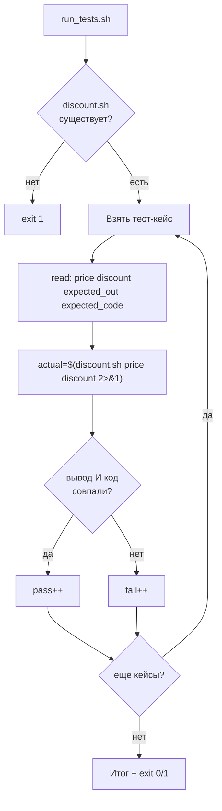

# Задача 3. Тестирование калькулятора скидок

## 3.1. Входные и выходные данные

### Скрипт под тестом: `discount.sh`

| Параметр | Описание |
| :--- | :--- |
| **Вход** | Два аргумента: цена (число ≥ 0) и процент скидки (число 0–100) |
| **Выход (STDOUT)** | Итоговая цена с двумя знаками после запятой (например, `900.00`) |
| **Код возврата** | `0` — успех, `1` — неверные аргументы или значения |
| **STDERR** | Сообщение об ошибке при неверных входных данных |

**Формула:** `итог = цена × (1 − скидка / 100)`

**Правила валидности:**
- Ровно два аргумента.
- Цена — неотрицательное число (целое или дробное).
- Скидка — число от 0 до 100 включительно.
- В Bash нет дробной арифметики — используем `awk`.

### Раннер: `run_tests.sh`

| Параметр | Описание |
| :--- | :--- |
| **Вход** | Нет аргументов |
| **Выход (STDOUT)** | `PASS:` / `FAIL:` по каждому кейсу + итоговая сводка |
| **Код возврата** | `0` — все тесты прошли, `1` — есть провалы или целевой скрипт не найден |

**Особенность:** сравнение чисел с двумя знаками после запятой. Оба вывода нормализованы через `printf "%.2f"` — сравнение строковое.

---

## 3.2. Пошаговое создание `discount.sh`

### Шаг 1. Шебанг и строгий режим

Создайте файл `discount.sh`. Первая строка — `#!/bin/bash`, вторая — `set -euo pipefail`. Строгий режим не даёт скрипту продолжать работу после сбоя.

**Рамочно:**
```bash
#!/bin/bash
set -euo pipefail
```

### Шаг 2. Проверить количество аргументов

Если `$# -ne 2` — вывести в `stderr` «Usage: …» и `exit 1`. Это защита от запуска без аргументов или с лишними.

**Рамочно:**
```bash
if [ $# -ne 2 ]; then ... fi
```

### Шаг 3. Захватить цену и скидку

`PRICE="$1"`, `DISCOUNT="$2"`. Дальше работаем с переменными, а не с позиционными аргументами.

### Шаг 4. Проверить, что цена — число

Регулярка `^[0-9]+(\.[0-9]+)?$` пропускает целые и дробные неотрицательные числа. Если не совпало — ошибка, `exit 1`. Отрицательная цена сюда не пройдёт, потому что нет знака `-`.

**Рамочно:**
```bash
if [[ ! "$PRICE" =~ ^[0-9]+(\.[0-9]+)?$ ]]; then ... fi
```

**Почему не `^-?`:** по условию цена не может быть отрицательной. Если хотите явно ловить отрицательную цену и выдавать отдельное сообщение — добавьте проверку `[[ "$PRICE" == -* ]]`.

### Шаг 5. Проверить, что скидка — число от 0 до 100

Две проверки:
- Формат: `^[0-9]+(\.[0-9]+)?$`.
- Диапазон: `awk` или `(( ))` с приведением к целому. Для дробных используйте `awk -v d="$DISCOUNT" 'BEGIN { exit (d >= 0 && d <= 100) ? 0 : 1 }'`.

**Рамочно:**
```bash
awk -v d="$DISCOUNT" 'BEGIN { exit (d >= 0 && d <= 100) ? 0 : 1 }' || ...
```

### Шаг 6. Вычислить итоговую цену через `awk`

```bash
result=$(awk -v p="$PRICE" -v d="$DISCOUNT" 'BEGIN { printf "%.2f", p * (1 - d/100) }')
```

**Разбор:**
- `-v p=… -v d=…` — передать переменные Bash в `awk`.
- `BEGIN { … }` — выполнить один раз, без чтения файла.
- `printf "%.2f"` — ровно два знака после запятой. Это нормализует формат: `900` станет `900.00`.

**Почему `%.2f`:** копейки. Если нужно рубли — `%.0f`, если нужна другая точность — поменяйте на `%.3f` и не забудьте поменять ожидания в раннере.

### Шаг 7. Вывести результат и код

`echo "$result"` и `exit 0`. При ошибке — `echo "ERROR" >&2` и `exit 1`.

**Важно:** результат всегда с двумя знаками после запятой. Это критично для раннера — сравнение будет строковым.

### Шаг 8. Сделать исполняемым и проверить вручную

`chmod +x discount.sh`. Прогоните:
```bash
./discount.sh 1000 10      # 900.00
./discount.sh 1000 0       # 1000.00
./discount.sh 1000 100     # 0.00
./discount.sh 500 50       # 250.00
./discount.sh -100 10      # ERROR, код 1
./discount.sh 1000 150     # ERROR, код 1
```

---

## 3.3. Пошаговое создание `run_tests.sh`

### Шаг 1. Шебанг и строгий режим

`#!/bin/bash` и `set -euo pipefail`.

### Шаг 2. Определить путь к целевому скрипту

`TARGET="./discount.sh"`. Одна переменная — легко менять.

### Шаг 3. Проверить, что целевой скрипт существует и исполняем

`[[ -x "$TARGET" ]] || { echo "..." >&2; exit 1; }`. Без этого первый же тест упадёт с невнятной ошибкой.

### Шаг 4. Объявить массив тест-кейсов

Формат: `"цена скидка ожидаемый_вывод ожидаемый_код"`. Примеры:
- `"1000 10 900.00 0"`
- `"1000 0 1000.00 0"`
- `"1000 100 0.00 0"`
- `"500 50 250.00 0"`
- `"99.99 10 89.99 0"` — дробная цена
- `"-100 10 ERROR 1"` — отрицательная цена
- `"1000 150 ERROR 1"` — скидка > 100
- `"1000 -5 ERROR 1"` — отрицательная скидка
- `"abc 10 ERROR 1"` — нечисловая цена

**Рамочно:**
```bash
TESTS=(
    "1000 10 900.00 0"
    ...
)
```

### Шаг 5. Завести счётчики

`pass=0` и `fail=0`. В конце они дадут итог и код возврата.

### Шаг 6. Цикл по тест-кейсам

`for t in "${TESTS[@]}"; do ... done`. Внутри — `read -r price discount expected_out expected_code <<< "$t"`. Четыре переменные; `read` разбивает строку по пробелам, `<<<` передаёт её на STDIN.

**Рамочно:**
```bash
for t in "${TESTS[@]}"; do
    read -r price discount expected_out expected_code <<< "$t"
    ...
done
```

### Шаг 7. Вызвать целевой скрипт и захватить вывод и код

```bash
actual_out=$("$TARGET" "$price" "$discount" 2>&1) || actual_code=$?
actual_code=${actual_code:-0}
```

**Разбор:**
- `2>&1` — объединяем stderr и stdout, чтобы поймать `ERROR` из `discount.sh`.
- `$(...)` — захватываем объединённый вывод.
- `|| actual_code=$?` — если скрипт вернул ненулевой код, запоминаем его.
- `${actual_code:-0}` — если код не был выставлен (успех), считаем 0.

**Важно:** под `set -e` конструкция `||` перехватывает ошибку, скрипт не прерывается.

### Шаг 8. Сравнить вывод и код

Оба должны совпасть:
```bash
if [[ "$actual_out" == "$expected_out" && "$actual_code" -eq "$expected_code" ]]; then
    echo "PASS: $t"
    pass=$((pass + 1))
else
    echo "FAIL: $t (получено: out='$actual_out', code=$actual_code)"
    fail=$((fail + 1))
fi
```

**Почему оба:** только вывод или только код недостаточно. Скрипт может вывести `900.00`, но вернуть код 1 — это баг.

**Важно:** используйте `pass=$((pass + 1))`, а не `((pass++))`. Под `set -e` пост-инкремент с нуля вернёт «ложь» и прервёт скрипт.

### Шаг 9. Итоговая сводка и код возврата

```bash
echo "Итого: PASS=$pass, FAIL=$fail"
[[ $fail -eq 0 ]] || exit 1
```

**Почему `exit 1`:** CI и cron видят код возврата. Если есть провалы — скрипт должен упасть.

### Шаг 10. Сделать исполняемым и запустить

`chmod +x run_tests.sh`. Запустите `./run_tests.sh`. Затем специально сломайте `discount.sh` (например, замените формулу на `p * (1 - d)` без деления на 100) и убедитесь, что раннер поймал регрессию.

---

## 3.4. Схема работы



---


# Чек-лист для задач

- [ ] Целевой скрипт проверяет число аргументов и выводит `Usage` при ошибке.
- [ ] Целевой скрипт возвращает разные коды для успеха и провала.
- [ ] Целевой скрипт пишет ошибки в `stderr`, результат — в `stdout`.
- [ ] Раннер проверяет существование и исполняемость целевого скрипта.
- [ ] Раннер хранит тест-кейсы в массиве.
- [ ] Раннер захватывает и вывод, и код возврата.
- [ ] Раннер сравнивает оба.
- [ ] Раннер считает `pass`/`fail` через `$((...))`, а не `((++))`.
- [ ] Раннер возвращает `exit 1` при наличии провалов.
- [ ] Оба скрипта проверены через `bash -n`.
- [ ] Оба скрипта запущены вручную и показали ожидаемый результат.