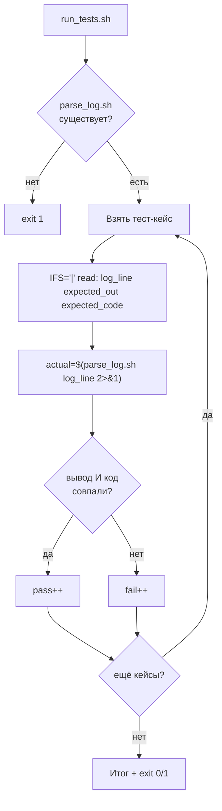

# Задача 4. Тестирование парсера логов

## 4.1. Входные и выходные данные

### Скрипт под тестом: `parse_log.sh`

| Параметр | Описание |
| :--- | :--- |
| **Вход** | Один аргумент — строка лога |
| **Выход (STDOUT)** | Первый найденный валидный IP-адрес |
| **Код возврата** | `0` — IP найден и валиден, `1` — IP нет / невалиден / пустая строка |
| **STDERR** | Сообщение об ошибке при неверных входных данных |

**Правила валидности IP:**
- Формат: четыре октета через точку.
- Каждый октет — число от 0 до 255.
- Октет не может быть пустым, не может содержать буквы.

**Пример строки лога:** `10.0.0.5 - - "GET /index" 200`

### Раннер: `run_tests.sh`

| Параметр | Описание |
| :--- | :--- |
| **Вход** | Нет аргументов |
| **Выход (STDOUT)** | `PASS:` / `FAIL:` по каждому кейсу + итог |
| **Код возврата** | `0` — все прошли, `1` — есть провалы |

**Особенность:** строка лога содержит пробелы и кавычки. В массиве тест-кейсов нельзя просто разделить по пробелам — сломается. Нужен другой формат хранения кейсов.

**Решение:** используем разделитель `|` вместо пробела. Формат кейса: `"строка_лога|ожидаемый_вывод|ожидаемый_код"`. `read` с `IFS='|'` разобьёт строку на три поля.

---

## 4.2. Пошаговое создание `parse_log.sh`

### Шаг 1. Шебанг и строгий режим

`#!/bin/bash` и `set -euo pipefail`.

### Шаг 2. Проверить количество аргументов

Если `$# -ne 1` — вывести в `stderr` «Usage: …» и `exit 1`.

**Рамочно:**
```bash
if [ $# -ne 1 ]; then ... fi
```

### Шаг 3. Захватить строку лога

`LOG="$1"`. Дальше работаем с переменной.

### Шаг 4. Проверить на пустую строку

Если `[ -z "$LOG" ]` — вывести `ERROR` в `stderr` и `exit 1`. Без этой проверки `grep` вернёт пусто, и мы потратим время на диагностику.

**Рамочно:**
```bash
if [ -z "$LOG" ]; then ... fi
```

### Шаг 5. Извлечь первый IP-адрес через `grep -oE`

```bash
ip=$(echo "$LOG" | grep -oE '\b([0-9]{1,3}\.){3}[0-9]{1,3}\b' | head -1)
```

**Разбор:**
- `grep -oE` — вывести только совпавшую часть строки, расширенная регулярка.
- `\b` — граница слова, чтобы не поймать `1234.5.6.7` как `234.5.6.7`.
- `([0-9]{1,3}\.){3}` — три группы «1–3 цифры и точка».
- `[0-9]{1,3}` — четвёртый октет.
- `| head -1` — берём первый найденный IP (если в строке их два).

**Что важно:** `grep -oE` может вернуть невалидные IP вида `999.999.999.999`. Регулярка проверяет только формат, но не диапазон. Валидацию диапазона делаем на следующем шаге.

### Шаг 6. Проверить, что IP найден

Если `ip` пустой — вывести `ERROR` в `stderr` и `exit 1`.

**Рамочно:**
```bash
if [ -z "$ip" ]; then ... fi
```

### Шаг 7. Валидировать октеты (0–255)

```bash
echo "$ip" | awk -F'.' '{
    for (i = 1; i <= 4; i++) {
        if ($i < 0 || $i > 255) exit 1
    }
    exit 0
}' || { echo "ERROR" >&2; exit 1; }
```

**Разбор:**
- `-F'.'` — разделитель полей — точка.
- Цикл по четырём октетам.
- `awk` неявно приводит строку к числу: `"999"` → `999`. Сравнение `> 255` сработает.
- Если хоть один октет вне диапазона — `exit 1`, и внешняя конструкция `||` вызовет ошибку.

**Важно:** `awk` может привести `"abc"` к `0`. Но на этом шаге `ip` уже прошёл `grep -oE` с `[0-9]{1,3}` — там только цифры. Так что `abc` сюда не попадёт.

### Шаг 8. Вывести IP и код

`echo "$ip"` и `exit 0`. При ошибке — `echo "ERROR" >&2` и `exit 1`.

### Шаг 9. Сделать исполняемым и проверить вручную

`chmod +x parse_log.sh`. Прогоните:
```bash
./parse_log.sh '10.0.0.5 - - "GET /index" 200'   # 10.0.0.5
./parse_log.sh 'no ip here'                       # ERROR, код 1
./parse_log.sh ''                                 # ERROR, код 1
./parse_log.sh '999.999.999.999 invalid'          # ERROR, код 1
./parse_log.sh '192.168.1.1 and 10.0.0.5'         # 192.168.1.1 (первый)
```

---

## 4.3. Пошаговое создание `run_tests.sh`

### Шаг 1. Шебанг и строгий режим

`#!/bin/bash` и `set -euo pipefail`.

### Шаг 2. Определить путь к целевому скрипту

`TARGET="./parse_log.sh"`.

### Шаг 3. Проверить, что целевой скрипт существует и исполняем

`[[ -x "$TARGET" ]] || { echo "..." >&2; exit 1; }`.

### Шаг 4. Объявить массив тест-кейсов с разделителем `|`

Формат: `"строка_лога|ожидаемый_вывод|ожидаемый_код"`. Примеры:
- `'10.0.0.5 - - "GET /index" 200|10.0.0.5|0'`
- `'8.8.8.8 - - "GET /" 200|8.8.8.8|0'`
- `'no ip here|ERROR|1'`
- `'|ERROR|1'` — пустая строка
- `'999.999.999.999 invalid|ERROR|1'` — невалидные октеты
- `'192.168.1.1 and 10.0.0.5|192.168.1.1|0'` — два IP, берём первый
- `'1234.5.6.7 weird|ERROR|1'` — граница слова не даст `234.5.6.7` пройти как целый IP… но `grep` может вытащить `234.5.6.7` из `1234.5.6.7`. Проверьте, что ваш `parse_log.sh` это ловит. Если нет — добавьте проверку на `^`/`$` или используйте более строгую регулярку.

**Рамочно:**
```bash
TESTS=(
    '10.0.0.5 - - "GET /index" 200|10.0.0.5|0'
    ...
)
```

**Почему одинарные кавычки:** внутри строки есть двойные кавычки. Одинарные кавычки в Bash не интерпретируют содержимое — строка сохраняется как есть.

**Почему `|`:** строка лога содержит пробелы, и `read` с дефолтным `IFS` разбил бы её на много полей. `IFS='|'` даёт ровно три поля.

### Шаг 5. Завести счётчики

`pass=0` и `fail=0`.

### Шаг 6. Цикл по тест-кейсам с `IFS='|'`

```bash
for t in "${TESTS[@]}"; do
    IFS='|' read -r log_line expected_out expected_code <<< "$t"
    ...
done
```

**Разбор:**
- `IFS='|'` — временно меняем разделитель полей на `|` только для этой команды `read`.
- `read -r` — не интерпретировать обратные слеши.
- `<<< "$t"` — передать строку на STDIN `read`.
- Три переменные: `log_line`, `expected_out`, `expected_code`.

**Важно:** `IFS='|'` перед `read` — это локальная настройка только для этой команды. После `read` `IFS` возвращается к дефолтному. Если нужно сохранить — используйте `IFS='|' read …` без экспорта.

### Шаг 7. Вызвать целевой скрипт и захватить вывод и код

```bash
actual_out=$("$TARGET" "$log_line" 2>&1) || actual_code=$?
actual_code=${actual_code:-0}
```

**Разбор:**
- `2>&1` — объединяем stderr и stdout, чтобы поймать `ERROR`.
- `$(...)` — захватываем объединённый вывод.
- `|| actual_code=$?` — если скрипт вернул ненулевой код, запоминаем.
- `${actual_code:-0}` — если код не был выставлен (успех), считаем 0.

### Шаг 8. Сравнить вывод и код

```bash
if [[ "$actual_out" == "$expected_out" && "$actual_code" -eq "$expected_code" ]]; then
    echo "PASS: $t"
    pass=$((pass + 1))
else
    echo "FAIL: $t (получено: out='$actual_out', code=$actual_code)"
    fail=$((fail + 1))
fi
```

**Почему оба:** только вывод или только код недостаточно. Скрипт может вывести `10.0.0.5`, но вернуть код 1 — это баг.

**Важно:** `pass=$((pass + 1))`, а не `((pass++))`. Под `set -e` пост-инкремент с нуля вернёт «ложь» и прервёт скрипт.

### Шаг 9. Итоговая сводка и код возврата

```bash
echo "Итого: PASS=$pass, FAIL=$fail"
[[ $fail -eq 0 ]] || exit 1
```

### Шаг 10. Сделать исполняемым и запустить

`chmod +x run_tests.sh`. Запустите `./run_tests.sh`. Затем специально сломайте `parse_log.sh` (например, уберите проверку октетов) и убедитесь, что раннер поймал регрессию.

---

## 4.4. Схема работы



---

# Чек-лист для задач

- [ ] Целевой скрипт проверяет число аргументов и выводит `Usage` при ошибке.
- [ ] Целевой скрипт возвращает разные коды для успеха и провала.
- [ ] Целевой скрипт пишет ошибки в `stderr`, результат — в `stdout`.
- [ ] Раннер проверяет существование и исполняемость целевого скрипта.
- [ ] Раннер хранит тест-кейсы в массиве.
- [ ] Раннер захватывает и вывод, и код возврата.
- [ ] Раннер сравнивает оба.
- [ ] Раннер считает `pass`/`fail` через `$((...))`, а не `((++))`.
- [ ] Раннер возвращает `exit 1` при наличии провалов.
- [ ] Используется `IFS='|' read` — иначе строки с пробелами сломают разбор.
- [ ] Проверены через `bash -n`.
- [ ] Запущены вручную и показали ожидаемый результат.