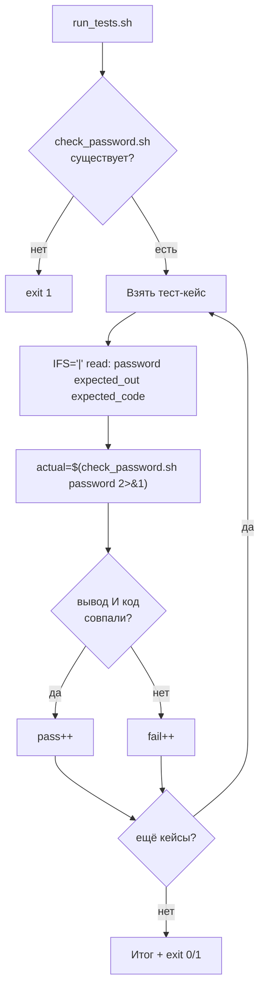

# Задача 5. Тестирование проверки пароля

## 5.1. Входные и выходные данные

### Скрипт под тестом: `check_password.sh`

| Параметр | Описание |
| :--- | :--- |
| **Вход** | Один аргумент — строка с паролем |
| **Выход (STDOUT)** | `STRONG` — если все правила выполнены, `WEAK` — если нет |
| **Код возврата** | `0` — пароль сильный, `1` — слабый или неверное число аргументов |
| **STDERR** | Сообщение об ошибке при неверном числе аргументов |

**Правила силы пароля (все четыре должны выполняться):**
1. Длина ≥ 8 символов.
2. Есть хотя бы одна цифра.
3. Есть хотя бы одна заглавная буква.
4. Есть хотя бы один спецсимвол (не буква и не цифра).

**Важно:** если хотя бы одно правило нарушено — пароль `WEAK`. Проверки не должны прерывать друг друга: нужно проверить все четыре и только потом сделать вывод.

### Раннер: `run_tests.sh`

| Параметр | Описание |
| :--- | :--- |
| **Вход** | Нет аргументов |
| **Выход (STDOUT)** | `PASS:` / `FAIL:` по каждому кейсу + итоговая сводка |
| **Код возврата** | `0` — все тесты прошли, `1` — есть провалы |

**Особенность:** в тест-кейсах пароли могут содержать спецсимволы (`!`, `@`, `#`, `$`, пробелы). При хранении в массиве и передаче в `read` это может сломаться. Используем разделитель `|` вместо пробела и `IFS='|' read`.

---

## 5.2. Пошаговое создание `check_password.sh`

### Шаг 1. Шебанг и строгий режим

`#!/bin/bash` и `set -euo pipefail`. Строгий режим нужен, чтобы скрипт не продолжал работу после сбоя.

**Рамочно:**
```bash
#!/bin/bash
set -euo pipefail
```

### Шаг 2. Проверить количество аргументов

Если `$# -ne 1` — вывести в `stderr` «Usage: …» и `exit 1`.

**Рамочно:**
```bash
if [ $# -ne 1 ]; then ... fi
```

### Шаг 3. Захватить пароль в переменную

`PASS="$1"`. Дальше работаем с переменной.

### Шаг 4. Завести счётчик нарушений

`violations=0`. Каждая неудачная проверка увеличивает счётчик на 1. В конце: `violations == 0` → `STRONG`, иначе `WEAK`.

**Почему счётчик, а не немедленный выход:** нужно проверить все правила, чтобы при отладке видеть, сколько именно нарушено. Это полезно для диагностики.

### Шаг 5. Проверить длину

Если `${#PASS} -lt 8` — `violations=$((violations + 1))`.

**Рамочно:**
```bash
if [ "${#PASS}" -lt 8 ]; then violations=$((violations + 1)); fi
```

**Важно:** `${#PASS}` считает **символы**, а не байты (в локали UTF-8). Для пароля из латиницы это одно и то же, но для кириллицы — нет. Если хотите считать байты — используйте `LC_ALL=C`.

### Шаг 6. Проверить наличие цифры

Если `[[ ! "$PASS" =~ [0-9] ]]` — `violations=$((violations + 1))`.

**Рамочно:**
```bash
if [[ ! "$PASS" =~ [0-9] ]]; then violations=$((violations + 1)); fi
```

**Почему `=~`, а не `grep`:** `[[ =~ ]]` — встроенная регулярка Bash, не запускает отдельный процесс. Быстрее и не зависит от `grep -P`.

### Шаг 7. Проверить наличие заглавной буквы

Если `[[ ! "$PASS" =~ [A-Z] ]]` — `violations=$((violations + 1))`.

**Рамочно:**
```bash
if [[ ! "$PASS" =~ [A-Z] ]]; then violations=$((violations + 1)); fi
```

**Важно:** `[A-Z]` в локали `en_US.UTF-8` может вести себя неожиданно (например, захватывать кириллические заглавные). Для строгой латиницы используйте `LC_ALL=C` перед проверкой или явный диапазон `[ABCDEFGHIJKLMNOPQRSTUVWXYZ]`.

### Шаг 8. Проверить наличие спецсимвола

Спецсимвол — это **не** буква и **не** цифра. Проверка:
```bash
if [[ ! "$PASS" =~ [^a-zA-Z0-9] ]]; then violations=$((violations + 1)); fi
```

**Рамочно:**
```bash
if [[ ! "$PASS" =~ [^a-zA-Z0-9] ]]; then violations=$((violations + 1)); fi
```

**Разбор:** `[^...]` — любой символ, кроме перечисленных. Если такого символа нет — правило нарушено.

### Шаг 9. Вывести результат и код

```bash
if [ "$violations" -eq 0 ]; then
    echo "STRONG"
    exit 0
else
    echo "WEAK"
    exit 1
fi
```

**Почему разные коды:** раннер сможет проверить и вывод, и код. Это надёжнее, чем полагаться только на текст.

### Шаг 10. Сделать исполняемым и проверить вручную

`chmod +x check_password.sh`. Прогоните:
```bash
./check_password.sh 'Abcd123!'     # STRONG, код 0
./check_password.sh 'abcd123!'     # WEAK (нет заглавной), код 1
./check_password.sh 'ABCD123!'     # WEAK (нет строчной — не правило, но проверьте)
./check_password.sh 'Abc123!'      # WEAK (короче 8), код 1
./check_password.sh 'Abcdefgh!'    # WEAK (нет цифры), код 1
./check_password.sh 'Abcd1234'     # WEAK (нет спецсимвола), код 1
./check_password.sh ''             # WEAK (пустой), код 1
```

**Обратите внимание:** пароль `ABCD123!` не нарушает ни одного из четырёх правил (длина 8, есть цифра, есть заглавная, есть спецсимвол) — он будет `STRONG`, хотя не содержит строчных. Если хотите добавить правило «есть строчная» — добавьте пятую проверку.

---

## 5.3. Пошаговое создание `run_tests.sh`

### Шаг 1. Шебанг и строгий режим

`#!/bin/bash` и `set -euo pipefail`.

### Шаг 2. Определить путь к целевому скрипту

`TARGET="./check_password.sh"`.

### Шаг 3. Проверить, что целевой скрипт существует и исполняем

`[[ -x "$TARGET" ]] || { echo "..." >&2; exit 1; }`.

### Шаг 4. Объявить массив тест-кейсов с разделителем `|`

Формат: `"пароль|ожидаемый_вывод|ожидаемый_код"`. Примеры:
- `'Abcd123!|STRONG|0'` — все правила
- `'abcd123!|WEAK|1'` — нет заглавной
- `'ABCD123!|STRONG|0'` — без строчных, но правила выполнены
- `'Abc123!|WEAK|1'` — короче 8
- `'Abcdefgh!|WEAK|1'` — нет цифры
- `'Abcd1234|WEAK|1'` — нет спецсимвола
- `'|WEAK|1'` — пустой пароль
- `'!@#$%^&*|WEAK|1'` — только спецсимволы (нет цифр, нет заглавных, длина 8)
- `'A1!a2@B#|STRONG|0'` — длина 8, всё есть

**Рамочно:**
```bash
TESTS=(
    'Abcd123!|STRONG|0'
    ...
)
```

**Почему `|`:** пароли могут содержать пробелы (например, `Abcd 123!`). Обычный `read` разбил бы строку на много полей. `IFS='|'` даёт ровно три.

### Шаг 5. Завести счётчики

`pass=0` и `fail=0`.

### Шаг 6. Цикл по тест-кейсам с `IFS='|'`

```bash
for t in "${TESTS[@]}"; do
    IFS='|' read -r password expected_out expected_code <<< "$t"
    ...
done
```

**Разбор:**
- `IFS='|'` — временно меняем разделитель полей только для этой команды `read`.
- `read -r` — не интерпретировать обратные слеши.
- `<<< "$t"` — передать строку на STDIN `read`.
- Три переменные: `password`, `expected_out`, `expected_code`.

**Важно:** `IFS='|'` — локальная настройка для одной команды. После `read` `IFS` возвращается к дефолтному.

### Шаг 7. Вызвать целевой скрипт и захватить вывод и код

```bash
actual_out=$("$TARGET" "$password" 2>&1) || actual_code=$?
actual_code=${actual_code:-0}
```

**Разбор:**
- `2>&1` — объединяем stderr и stdout, чтобы поймать `Usage` при ошибках.
- `$(...)` — захватываем объединённый вывод.
- `|| actual_code=$?` — если скрипт вернул ненулевой код, запоминаем.
- `${actual_code:-0}` — если код не был выставлен (успех), считаем 0.

**Важно:** под `set -e` конструкция `||` перехватывает ошибку, скрипт не прерывается.

### Шаг 8. Сравнить вывод и код

```bash
if [[ "$actual_out" == "$expected_out" && "$actual_code" -eq "$expected_code" ]]; then
    echo "PASS: '$password'"
    pass=$((pass + 1))
else
    echo "FAIL: '$password' (получено: out='$actual_out', code=$actual_code)"
    fail=$((fail + 1))
fi
```

**Почему оба:** скрипт может вывести `STRONG`, но вернуть код 1 — это баг. Раннер должен ловить и такое.

**Почему в кавычках при выводе:** пароль может содержать спецсимволы. Кавычки делают вывод читаемым.

**Важно:** `pass=$((pass + 1))`, а не `((pass++))`. Под `set -e` пост-инкремент с нуля вернёт «ложь» и прервёт скрипт.

### Шаг 9. Итоговая сводка и код возврата

```bash
echo "Итого: PASS=$pass, FAIL=$fail"
[[ $fail -eq 0 ]] || exit 1
```

### Шаг 10. Сделать исполняемым и запустить

`chmod +x run_tests.sh`. Запустите `./run_tests.sh`. Затем специально сломайте `check_password.sh` (например, уберите проверку на спецсимвол) и убедитесь, что раннер поймал регрессию.

---

## 5.4. Схема работы



---

# Чек-лист для задач

- [ ] Целевой скрипт проверяет число аргументов и выводит `Usage` при ошибке.
- [ ] Целевой скрипт возвращает разные коды для успеха и провала.
- [ ] Целевой скрипт пишет ошибки в `stderr`, результат — в `stdout` (или в файл).
- [ ] Раннер проверяет существование и исполняемость целевого скрипта.
- [ ] Раннер хранит тест-кейсы в массиве.
- [ ] Раннер захватывает и вывод, и код возврата.
- [ ] Раннер сравнивает оба.
- [ ] Раннер считает `pass`/`fail` через `$((...))`, а не `((++))`.
- [ ] Раннер возвращает `exit 1` при наличии провалов.
- [ ] Используется `IFS='|' read` — иначе спецсимволы сломают разбор.
- [ ] Оба скрипта проверены через `bash -n`.
- [ ] Оба скрипта запущены вручную и показали ожидаемый результат.
- [ ] Регрессия (специально внесённая ошибка) поймана раннером.