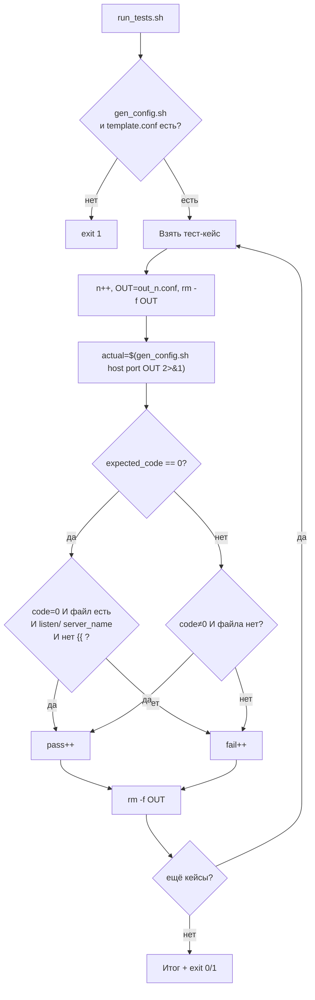

# Задача 6. Тестирование генератора конфига

## 6.1. Входные и выходные данные

### Скрипт под тестом: `gen_config.sh`

| Параметр | Описание |
| :--- | :--- |
| **Вход** | Три аргумента: имя хоста, порт, путь к выходному файлу |
| **Выход (STDOUT)** | `OK` — при успехе, `ERROR` — при ошибке (в `stderr`) |
| **Код возврата** | `0` — файл создан, `1` — ошибка |
| **Побочный эффект** | Создаёт выходной файл с подставленными значениями |

**Шаблон `template.conf`** (создаётся в песочнице один раз):
```
server {
    listen {{PORT}};
    server_name {{HOST}};
}
```

**Правила валидности:**
- Ровно три аргумента.
- Хост не пустой.
- Порт — целое число от 1 до 65535.
- Шаблон `template.conf` существует в текущей директории.

**Важно:** генератор должен **создать** выходной файл, а не вывести в STDOUT. Это ближе к реальной задаче (деплой конфига). Раннер будет проверять содержимое файла.

### Раннер: `run_tests.sh`

| Параметр | Описание |
| :--- | :--- |
| **Вход** | Нет аргументов |
| **Выход (STDOUT)** | `PASS:` / `FAIL:` + итог |
| **Код возврата** | `0` — все прошли, `1` — есть провалы |

**Особенность:** для каждого теста нужен свой выходной файл, иначе тесты перезапишут друг друга. Раннер создаёт `out_$N.conf` для теста N, проверяет его и удаляет.

---

## 6.2. Пошаговое создание `gen_config.sh`

### Шаг 1. Шебанг и строгий режим

`#!/bin/bash` и `set -euo pipefail`.

### Шаг 2. Проверить количество аргументов

Если `$# -ne 3` — вывести `Usage` в `stderr` и `exit 1`.

**Рамочно:**
```bash
if [ $# -ne 3 ]; then ... fi
```

### Шаг 3. Захватить аргументы

`HOST="$1"`, `PORT="$2"`, `OUTPUT="$3"`. Дальше работаем с переменными.

### Шаг 4. Проверить, что хост не пустой

Если `[ -z "$HOST" ]` — вывести `ERROR` в `stderr`, `exit 1`. Пустой `server_name` — невалидный конфиг nginx.

**Рамочно:**
```bash
if [ -z "$HOST" ]; then ... fi
```

### Шаг 5. Проверить, что порт — целое число в диапазоне 1–65535

Две проверки:
- Формат: `[[ "$PORT" =~ ^[0-9]+$ ]]` — только цифры.
- Диапазон: `[ "$PORT" -ge 1 ] && [ "$PORT" -le 65535 ]`.

**Рамочно:**
```bash
if [[ ! "$PORT" =~ ^[0-9]+$ ]]; then ... fi
if [ "$PORT" -lt 1 ] || [ "$PORT" -gt 65535 ]; then ... fi
```

**Почему не `=~ ^[0-9]{1,5}$`:** 5 цифр — это ещё не гарантия диапазона (`99999 > 65535`). Числовое сравнение точнее.

### Шаг 6. Проверить, что шаблон существует

Если `[ ! -f "template.conf" ]` — вывести `ERROR` в `stderr`, `exit 1`. Без шаблона подставлять некуда.

**Рамочно:**
```bash
if [ ! -f "template.conf" ]; then ... fi
```

### Шаг 7. Выполнить подстановку через `sed`

```bash
sed -e "s/{{HOST}}/$HOST/g" -e "s/{{PORT}}/$PORT/g" template.conf > "$OUTPUT"
```

**Разбор:**
- `-e "s/{{HOST}}/$HOST/g"` — заменить все `{{HOST}}` на значение хоста.
- `-e "s/{{PORT}}/$PORT/g"` — заменить все `{{PORT}}` на значение порта.
- `> "$OUTPUT"` — записать результат в выходной файл.

**Почему двойные кавычки в `sed`:** нужна подстановка переменных `$HOST` и `$PORT`. Одинарные кавычки не подставят значения.

**Подводный камень:** если `$HOST` содержит `/` (например, `example.com/path`), `sed` сломается. Для нашего случая (hostname) это маловероятно, но в реальной задаче используйте другой разделитель: `s|{{HOST}}|$HOST|g`.

### Шаг 8. Проверить, что в выходном файле не осталось плейсхолдеров

```bash
if grep -q '{{' "$OUTPUT"; then
    echo "ERROR: placeholders remain" >&2
    exit 1
fi
```

**Зачем:** если в шаблоне есть `{{SOMETHING_ELSE}}`, которого нет в подстановке, — конфиг невалиден. Лучше упасть, чем задеплоить сломанный конфиг.

**Рамочно:**
```bash
if grep -q '{{' "$OUTPUT"; then ... fi
```

### Шаг 9. Вывести результат и код

`echo "OK"` и `exit 0`.

### Шаг 10. Сделать исполняемым и проверить вручную

Сначала создайте `template.conf` (он должен быть в той же директории, где запускаете `gen_config.sh`). Затем `chmod +x gen_config.sh`. Прогоните:
```bash
./gen_config.sh example.com 8080 out.conf
cat out.conf
# server {
#     listen 8080;
#     server_name example.com;
# }
./gen_config.sh "" 8080 out.conf     # ERROR, код 1
./gen_config.sh example.com 99999 out.conf   # ERROR, код 1
./gen_config.sh example.com abc out.conf     # ERROR, код 1
```

---

## 6.3. Пошаговое создание `run_tests.sh`

### Шаг 1. Шебанг и строгий режим

`#!/bin/bash` и `set -euo pipefail`.

### Шаг 2. Определить путь к целевому скрипту и шаблону

`TARGET="./gen_config.sh"`, `TEMPLATE="./template.conf"`.

### Шаг 3. Проверить, что целевой скрипт и шаблон существуют

Две проверки:
```bash
[[ -x "$TARGET" ]] || { echo "..." >&2; exit 1; }
[[ -f "$TEMPLATE" ]] || { echo "..." >&2; exit 1; }
```

**Почему проверять шаблон:** без него все тесты упадут с одной и той же ошибкой, и вы не поймёте, в чём дело.

### Шаг 4. Объявить массив тест-кейсов

Формат: `"хост|порт|ожидаемый_код"`. Примеры:
- `'example.com|8080|0'` — валидные значения
- `'localhost|80|0'` — короткое имя
- `'0.0.0.0|1|0'` — граничный порт
- `'example.com|65535|0'` — верхняя граница
- `'example.com|65536|1'` — порт вне диапазона
- `'example.com|0|1'` — порт ниже диапазона
- `'|8080|1'` — пустой хост
- `'example.com|abc|1'` — нечисловой порт

**Рамочно:**
```bash
TESTS=(
    'example.com|8080|0'
    ...
)
```

**Почему `|`:** строка `0.0.0.0` содержит точки, но не пробелы, поэтому `IFS='|'` не обязателен. Однако для единообразия с задачей 5 и на случай будущих кейсов с пробелами — используем `|`.

### Шаг 5. Завести счётчики и номер теста

`pass=0`, `fail=0`, `n=0`. `n` нужен для уникального имени выходного файла на каждый тест.

### Шаг 6. Цикл по тест-кейсам

```bash
for t in "${TESTS[@]}"; do
    IFS='|' read -r host port expected_code <<< "$t"
    n=$((n + 1))
    ...
done
```

### Шаг 7. Подготовить выходной файл и запустить генератор

```bash
OUT="out_${n}.conf"
rm -f "$OUT"
actual_out=$("$TARGET" "$host" "$port" "$OUT" 2>&1) || actual_code=$?
actual_code=${actual_code:-0}
```

**Разбор:**
- `rm -f "$OUT"` — гарантировать, что файл не остался от предыдущего запуска. Иначе проверка «файл создан» будет ложно-положительной.
- `2>&1` — объединить stderr и stdout.
- `|| actual_code=$?` — запомнить код ошибки.
- `${actual_code:-0}` — успех = 0.

**Важно:** `set -e` не прервёт скрипт, потому что `||` перехватывает ошибку.

### Шаг 8. Проверить результат

Для успешных кейсов (`expected_code == 0`) нужно проверить три вещи:
1. `actual_code == 0`.
2. Файл `$OUT` существует.
3. В файле есть `listen $port;` и `server_name $host;` — и нет плейсхолдеров `{{`.

Для неуспешных кейсов (`expected_code == 1`):
1. `actual_code == 1`.
2. Файл `$OUT` не существует **или** пустой (в зависимости от реализации — у нас генератор не создаёт файл при ошибке, поэтому проверяем отсутствие).

**Рамочно:**
```bash
if [ "$expected_code" -eq 0 ]; then
    if [ "$actual_code" -eq 0 ] \
       && [ -f "$OUT" ] \
       && grep -q "listen $port;" "$OUT" \
       && grep -q "server_name $host;" "$OUT" \
       && ! grep -q '{{' "$OUT"; then
        PASS
    else
        FAIL
    fi
else
    if [ "$actual_code" -ne 0 ] && [ ! -f "$OUT" ]; then
        PASS
    else
        FAIL
    fi
fi
```

**Почему несколько `grep -q`:** каждый проверяет одно условие. `&&` соединяет их: PASS только если все истинны. `grep -q` возвращает 0 при нахождении, 1 при отсутствии — с `!` инвертируем.

**Альтернатива:** собрать ожидаемое содержимое файла в переменную через `$(cat <<EOF ...)` и сравнить с `diff`. Это чище, но многословнее. Для начала хватит `grep -q`.

### Шаг 9. Увеличить счётчики и вывести результат

```bash
if PASS; then
    echo "PASS: $t"
    pass=$((pass + 1))
else
    echo "FAIL: $t (out='$actual_out', code=$actual_code)"
    fail=$((fail + 1))
fi
rm -f "$OUT"
```

**Почему `rm -f "$OUT"` в конце:** не засорять директорию. Файлы для отладки не нужны, если тест прошёл.

### Шаг 10. Итоговая сводка и код возврата

```bash
echo "Итого: PASS=$pass, FAIL=$fail"
[[ $fail -eq 0 ]] || exit 1
```

### Шаг 11. Сделать исполняемым и запустить

`chmod +x run_tests.sh`. Запустите `./run_tests.sh`. Затем специально сломайте `gen_config.sh` (например, уберите проверку диапазона порта) и убедитесь, что раннер поймал регрессию на кейсе `65536`.

---

## 6.4. Схема работы



---

# Чек-лист для задач

- [ ] Целевой скрипт проверяет число аргументов и выводит `Usage` при ошибке.
- [ ] Целевой скрипт возвращает разные коды для успеха и провала.
- [ ] Целевой скрипт пишет ошибки в `stderr`, результат — в файл.
- [ ] Раннер проверяет существование и исполняемость целевого скрипта.
- [ ] Раннер хранит тест-кейсы в массиве.
- [ ] Раннер захватывает и вывод, и код возврата.
- [ ] Раннер сравнивает оба.
- [ ] Раннер считает `pass`/`fail` через `$((...))`, а не `((++))`.
- [ ] Раннер возвращает `exit 1` при наличии провалов.
- [ ] Каждый тест использует свой выходной файл и удаляет его после проверки.
- [ ] Оба скрипта проверены через `bash -n`.
- [ ] Оба скрипта запущены вручную и показали ожидаемый результат.
- [ ] Регрессия (специально внесённая ошибка) поймана раннером.