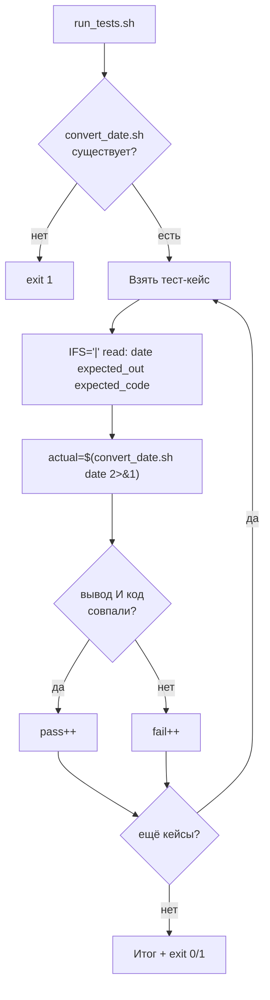

# Задача 7. Тестирование конвертера дат

## 7.1. Входные и выходные данные

### Скрипт под тестом: `convert_date.sh`

| Параметр | Описание |
| :--- | :--- |
| **Вход** | Один аргумент — дата в формате `YYYY-MM-DD` |
| **Выход (STDOUT)** | Дата в формате `DD/MM/YYYY` (например, `25/12/2023`) |
| **Код возврата** | `0` — дата валидна и сконвертирована, `1` — невалидная дата или неверное число аргументов |
| **STDERR** | Сообщение об ошибке при неверных входных данных |

**Правила валидности:**
- Ровно один аргумент.
- Формат строго `YYYY-MM-DD`: 4 цифры, дефис, 2 цифры, дефис, 2 цифры.
- Год — от 1900 до 2100 включительно.
- Месяц — от 01 до 12.
- День — от 01 до максимального для этого месяца и года.
- Високосный год: делится на 4, но не на 100, **кроме** случаев, когда делится на 400.

**Важно:** високосный год — главный подводный камень. Февраль 2023 = 28 дней, февраль 2024 = 29 дней, февраль 1900 = 28 дней (делится на 100, но не на 400), февраль 2000 = 29 дней (делится на 400).

### Раннер: `run_tests.sh`

| Параметр | Описание |
| :--- | :--- |
| **Вход** | Нет аргументов |
| **Выход (STDOUT)** | `PASS:` / `FAIL:` по каждому кейсу + итоговая сводка |
| **Код возврата** | `0` — все тесты прошли, `1` — есть провалы |

**Особенность:** дата содержит дефисы, но не пробелы. Формат кейсов `"дата|ожидаемый_вывод|ожидаемый_код"` с `IFS='|'` — единообразно с предыдущими задачами.

---

## 7.2. Пошаговое создание `convert_date.sh`

### Шаг 1. Шебанг и строгий режим

`#!/bin/bash` и `set -euo pipefail`.

**Рамочно:**
```bash
#!/bin/bash
set -euo pipefail
```

### Шаг 2. Проверить количество аргументов

Если `$# -ne 1` — вывести `Usage` в `stderr` и `exit 1`.

**Рамочно:**
```bash
if [ $# -ne 1 ]; then ... fi
```

### Шаг 3. Захватить дату в переменную

`DATE="$1"`. Дальше работаем с переменной.

### Шаг 4. Проверить формат регуляркой

```bash
if [[ ! "$DATE" =~ ^([0-9]{4})-([0-9]{2})-([0-9]{2})$ ]]; then
    echo "ERROR: invalid format" >&2
    exit 1
fi
```

**Разбор:**
- `^...$` — якоря начала и конца. Без них `2023-12-25extra` пройдёт проверку.
- `([0-9]{4})` — ровно 4 цифры для года.
- `([0-9]{2})` — ровно 2 цифры для месяца и дня.
- `-` — литеральный дефис.

**Почему регулярка, а не `cut`:** `cut -d '-' -f 1` на строке `2023-1-1` вернёт `1`, а не `01`. Регулярка строже.

### Шаг 5. Извлечь компоненты через `BASH_REMATCH`

После успешной проверки `[[ =~ ]]` переменная `BASH_REMATCH` содержит захваченные группы:
```bash
YEAR="${BASH_REMATCH[1]}"
MONTH="${BASH_REMATCH[2]}"
DAY="${BASH_REMATCH[3]}"
```

**Почему `BASH_REMATCH`, а не `${DATE:0:4}`:** `BASH_REMATCH` работает уже после проверки формата и не требует дополнительных вычислений индексов. Плюс, если формат изменится (например, добавим время), не придётся пересчитывать позиции.

### Шаг 6. Проверить год

`[ "$YEAR" -ge 1900 ] && [ "$YEAR" -le 2100 ]`. Если нет — `ERROR`, `exit 1`.

**Рамочно:**
```bash
if [ "$YEAR" -lt 1900 ] || [ "$YEAR" -gt 2100 ]; then ... fi
```

**Важно:** `[ "$YEAR" -lt 1900 ]` вызовет ошибку, если `YEAR` — не число. Но к этому моменту формат уже проверен, и `YEAR` гарантированно 4 цифры.

### Шаг 7. Проверить месяц

`[ "$MONTH" -ge 1 ] && [ "$MONTH" -le 12 ]`. Если нет — `ERROR`, `exit 1`.

**Важно:** `08` в Bash при `-ge` интерпретируется как десятичное 8, а не как восьмеричное. Это поведение `[ ]` для строк с ведущим нулём — оно безопасно, но если хотите избежать сюрпризов, используйте `$((10#$MONTH))` для принудительного десятичного разбора.

### Шаг 8. Вычислить максимальное число дней для месяца

**Правило:**
- Апрель, июнь, сентябрь, ноябрь — 30 дней.
- Февраль — 28 или 29 (зависит от года).
- Остальные — 31 день.

**Логика на `case`:**
```bash
case "$MONTH" in
    01|03|05|07|08|10|12) MAX_DAY=31 ;;
    04|06|09|11)          MAX_DAY=30 ;;
    02)
        if (( YEAR % 400 == 0 )) || { (( YEAR % 4 == 0 )) && (( YEAR % 100 != 0 )); }; then
            MAX_DAY=29
        else
            MAX_DAY=28
        fi
        ;;
esac
```

**Разбор високосного правила:**
- `YEAR % 400 == 0` — 2000, 2400 → високосный.
- `YEAR % 4 == 0 && YEAR % 100 != 0` — 2024, 2028 → високосный.
- `YEAR % 100 == 0 && YEAR % 400 != 0` — 1900, 2100 → **не** високосный.

**Рамочно:**
```bash
case "$MONTH" in ... esac
```

### Шаг 9. Проверить день

`[ "$DAY" -ge 1 ] && [ "$DAY" -le "$MAX_DAY" ]`. Если нет — `ERROR`, `exit 1`.

**Рамочно:**
```bash
if [ "$DAY" -lt 1 ] || [ "$DAY" -gt "$MAX_DAY" ]; then ... fi
```

### Шаг 10. Вывести результат и код

```bash
echo "$DAY/$MONTH/$YEAR"
exit 0
```

**Важно:** порядок — `DD/MM/YYYY`, а не `YYYY/MM/DD`. Это критично для раннера.

### Шаг 11. Сделать исполняемым и проверить вручную

`chmod +x convert_date.sh`. Прогоните:
```bash
./convert_date.sh 2023-12-25     # 25/12/2023, код 0
./convert_date.sh 2024-02-29     # 29/02/2024, код 0 (високосный)
./convert_date.sh 2023-02-29     # ERROR, код 1 (не високосный)
./convert_date.sh 1900-02-29     # ERROR, код 1 (1900 не високосный)
./convert_date.sh 2000-02-29     # 29/02/2000, код 0 (2000 високосный)
./convert_date.sh 2023-13-01     # ERROR, код 1 (месяц 13)
./convert_date.sh 2023-04-31     # ERROR, код 1 (апрель — 30 дней)
./convert_date.sh 2023-1-1       # ERROR, код 1 (неверный формат)
```

---

## 7.3. Пошаговое создание `run_tests.sh`

### Шаг 1. Шебанг и строгий режим

`#!/bin/bash` и `set -euo pipefail`.

### Шаг 2. Определить путь к целевому скрипту

`TARGET="./convert_date.sh"`.

### Шаг 3. Проверить, что целевой скрипт существует и исполняем

`[[ -x "$TARGET" ]] || { echo "..." >&2; exit 1; }`.

### Шаг 4. Объявить массив тест-кейсов

Формат: `"дата|ожидаемый_вывод|ожидаемый_код"`. Примеры:
- `'2023-12-25|25/12/2023|0'` — обычная дата
- `'2024-02-29|29/02/2024|0'` — високосный год
- `'2023-02-28|28/02/2023|0'` — последний день февраля
- `'2023-02-29|ERROR|1'` — не високосный год
- `'1900-02-29|ERROR|1'` — 1900 не високосный (делится на 100, но не на 400)
- `'2000-02-29|29/02/2000|0'` — 2000 високосный (делится на 400)
- `'2023-01-01|01/01/2023|0'` — начало года
- `'2023-12-31|31/12/2023|0'` — конец года
- `'2023-04-31|ERROR|1'` — апрель — 30 дней
- `'2023-13-01|ERROR|1'` — месяц 13
- `'2023-00-01|ERROR|1'` — месяц 00
- `'2023-1-1|ERROR|1'` — неверный формат
- `'abc|ERROR|1'` — не дата
- `'|ERROR|1'` — пустая строка
- `'1899-12-31|ERROR|1'` — год вне диапазона
- `'2101-01-01|ERROR|1'` — год вне диапазона

**Рамочно:**
```bash
TESTS=(
    '2023-12-25|25/12/2023|0'
    ...
)
```

**Почему `|`:** дата содержит дефисы, но не пробелы. Тем не менее `|` — единый формат для всех задач раннера. Если добавите кейс с датой вида `2023-12-25 extra`, `IFS='|'` всё равно разберёт его правильно.

### Шаг 5. Завести счётчики

`pass=0` и `fail=0`.

### Шаг 6. Цикл по тест-кейсам

```bash
for t in "${TESTS[@]}"; do
    IFS='|' read -r date expected_out expected_code <<< "$t"
    ...
done
```

### Шаг 7. Вызвать целевой скрипт и захватить вывод и код

```bash
actual_out=$("$TARGET" "$date" 2>&1) || actual_code=$?
actual_code=${actual_code:-0}
```

**Разбор:**
- `2>&1` — объединяем stderr и stdout, чтобы поймать `ERROR` из `convert_date.sh`.
- `$(...)` — захватываем объединённый вывод.
- `|| actual_code=$?` — если скрипт вернул ненулевой код, запоминаем.
- `${actual_code:-0}` — если код не был выставлен (успех), считаем 0.

**Важно:** под `set -e` конструкция `||` перехватывает ошибку, скрипт не прерывается.

### Шаг 8. Сравнить вывод и код

```bash
if [[ "$actual_out" == "$expected_out" && "$actual_code" -eq "$expected_code" ]]; then
    echo "PASS: $t"
    pass=$((pass + 1))
else
    echo "FAIL: $t (получено: out='$actual_out', code=$actual_code)"
    fail=$((fail + 1))
fi
```

**Почему оба:** скрипт может вывести `25/12/2023`, но вернуть код 1 — это баг. Раннер должен ловить и такое.

**Важно:** `pass=$((pass + 1))`, а не `((pass++))`. Под `set -e` пост-инкремент с нуля вернёт «ложь» и прервёт скрипт.

### Шаг 9. Итоговая сводка и код возврата

```bash
echo "Итого: PASS=$pass, FAIL=$fail"
[[ $fail -eq 0 ]] || exit 1
```

### Шаг 10. Сделать исполняемым и запустить

`chmod +x run_tests.sh`. Запустите `./run_tests.sh`. Затем специально сломайте `convert_date.sh` (например, уберите проверку високосного года или разрешите 32-е число) и убедитесь, что раннер поймал регрессию.

---

## 7.4. Схема работы



---

# Чек-лист для задач

- [ ] Целевой скрипт проверяет число аргументов и выводит `Usage` при ошибке.
- [ ] Целевой скрипт возвращает разные коды для «получил результат» и «ошибка».
- [ ] Целевой скрипт пишет ошибки в `stderr`, результат — в `stdout`.
- [ ] Раннер проверяет существование и исполняемость целевого скрипта.
- [ ] Раннер хранит тест-кейсы в массиве.
- [ ] Раннер захватывает и вывод, и код возврата.
- [ ] Раннер сравнивает оба.
- [ ] Раннер считает `pass`/`fail` через `$((...))`, а не `((++))`.
- [ ] Раннер возвращает `exit 1` при наличии провалов.
- [ ] Проверены високосные граничные случаи: 1900 (не високосный), 2000 (високосный), 2024 (високосный), 2023 (не високосный).
- [ ] Оба скрипта проверены через `bash -n`.
- [ ] Оба скрипта запущены вручную и показали ожидаемый результат.
- [ ] Регрессия (специально внесённая ошибка) поймана раннером.