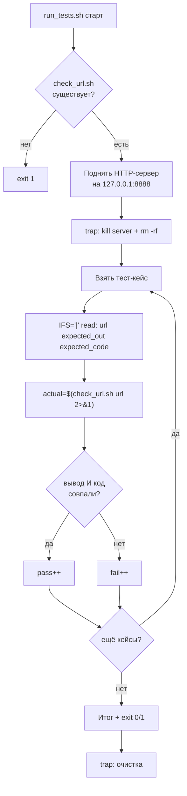

# Задача 8. Тестирование проверки URL

## 8.1. Входные и выходные данные

### Скрипт под тестом: `check_url.sh`

| Параметр | Описание |
| :--- | :--- |
| **Вход** | Один аргумент — URL (http:// или https://) |
| **Выход (STDOUT)** | Трёхзначный HTTP-статус (например, `200`, `404`, `500`) |
| **Код возврата** | `0` — удалось получить статус (любой), `1` — неверный URL или сетевая ошибка |
| **STDERR** | Сообщение об ошибке при неверных входных данных |

**Правила валидности URL:**
- Ровно один аргумент.
- Не пустой.
- Начинается с `http://` или `https://`.

**Логика получения статуса:**
```bash
curl -o /dev/null -s -w "%{http_code}" --max-time 5 "$URL"
```

**Разбор:**
- `-o /dev/null` — тело ответа не нужно, только статус.
- `-s` — silent, без прогресс-бара.
- `-w "%{http_code}"` — вывести только код статуса.
- `--max-time 5` — не висеть на медленных серверах.

**Возвращаемое значение:** `200`, `404`, `500` и т.д. Если curl не смог подключиться — вернёт `000`. Это тоже нужно обработать.

**Важно про тестирование:** нельзя полагаться на внешние URL — они меняются, падают, замедляются. Для детерминированных тестов поднимем **локальный HTTP-сервер** в песочнице. Это даёт стабильные статусы (200 и 404) и не требует интернета.

### Раннер: `run_tests.sh`

| Параметр | Описание |
| :--- | :--- |
| **Вход** | Нет аргументов |
| **Выход (STDOUT)** | `PASS:` / `FAIL:` + итог |
| **Код возврата** | `0` — все прошли, `1` — есть провалы |

**Особенность:** раннер сам поднимает локальный HTTP-сервер на время тестов и гасит его после. Это делает тесты воспроизводимыми в любой среде.

---

## 8.2. Пошаговое создание `check_url.sh`

### Шаг 1. Шебанг и строгий режим

`#!/bin/bash` и `set -euo pipefail`.

**Рамочно:**
```bash
#!/bin/bash
set -euo pipefail
```

### Шаг 2. Проверить количество аргументов

Если `$# -ne 1` — вывести `Usage` в `stderr` и `exit 1`.

**Рамочно:**
```bash
if [ $# -ne 1 ]; then ... fi
```

### Шаг 3. Захватить URL в переменную

`URL="$1"`.

### Шаг 4. Проверить, что URL не пустой

Если `[ -z "$URL" ]` — вывести `ERROR` в `stderr` и `exit 1`.

**Рамочно:**
```bash
if [ -z "$URL" ]; then ... fi
```

**Зачем отдельная проверка:** `curl` на пустой строке вернёт ошибку с невнятным сообщением. Лучше отловить заранее.

### Шаг 5. Проверить формат URL

```bash
if [[ ! "$URL" =~ ^https?:// ]]; then
    echo "ERROR: invalid URL" >&2
    exit 1
fi
```

**Разбор:**
- `^https?://` — начало строки, `http`, опциональная `s`, `://`.
- `?` после `s` — ноль или один символ. Пропускает и `http://`, и `https://`.

**Почему не проверять всё регуляркой:** полная валидация URL — сложна и не нужна. Достаточно убедиться, что схема правильная, — остальное `curl` сам проверит.

### Шаг 6. Вызвать `curl` и захватить статус

```bash
status=$(curl -o /dev/null -s -w "%{http_code}" --max-time 5 "$URL" 2>/dev/null) || status="000"
```

**Разбор:**
- `-o /dev/null` — тело в никуда.
- `-s` — без прогресс-бара.
- `-w "%{http_code}"` — только статус.
- `--max-time 5` — таймаут 5 секунд.
- `2>/dev/null` — ошибки curl не нужны.
- `|| status="000"` — если curl упал (не смог подключиться), статус `000`.

**Почему `|| status="000"`:** curl возвращает ненулевой код при сетевой ошибке, но при `--max-time` может вывести `000` в STDOUT. Унифицируем: любой сбой — `000`.

**Важно про `set -e`:** `||` перехватывает ошибку, скрипт не прерывается.

### Шаг 7. Проверить, что статус получен

Если `status="000"` — вывести `ERROR` в `stderr` и `exit 1`. Если статус не `000` — вывести его и `exit 0`.

**Рамочно:**
```bash
if [ "$status" = "000" ]; then ... fi
```

### Шаг 8. Вывести результат и код

```bash
echo "$status"
exit 0
```

**Почему `exit 0` даже для `404`:** задача скрипта — **получить** статус, а не оценить его. `404` — это валидный ответ сервера. Код возврата отражает успех **проверки**, а не успех **URL**.

### Шаг 9. Сделать исполняемым и проверить вручную

`chmod +x check_url.sh`. Сначала поднимите локальный сервер:
```bash
mkdir -p /tmp/urltest && cd /tmp/urltest
echo "OK" > index.html
python3 -m http.server 8888 &
SERVER_PID=$!
```

Затем прогоните:
```bash
./check_url.sh http://127.0.0.1:8888/          # 200, код 0
./check_url.sh http://127.0.0.1:8888/missing   # 404, код 0
./check_url.sh http://127.0.0.1:9999/          # 000, код 1
./check_url.sh not-a-url                       # ERROR, код 1
./check_url.sh ""                              # ERROR, код 1
kill $SERVER_PID
```

---

## 8.3. Пошаговое создание `run_tests.sh`

### Шаг 1. Шебанг и строгий режим

`#!/bin/bash` и `set -euo pipefail`.

### Шаг 2. Определить путь к целевому скрипту

`TARGET="./check_url.sh"`.

### Шаг 3. Проверить, что целевой скрипт существует и исполняем

`[[ -x "$TARGET" ]] || { echo "..." >&2; exit 1; }`.

### Шаг 4. Поднять локальный HTTP-сервер для тестов

```bash
TEST_DIR=$(mktemp -d)
echo "OK" > "$TEST_DIR/index.html"
python3 -m http.server 8888 --directory "$TEST_DIR" > /dev/null 2>&1 &
SERVER_PID=$!
sleep 1
```

**Разбор:**
- `mktemp -d` — временная директория, куда положим `index.html`.
- `python3 -m http.server 8888 --directory "$TEST_DIR"` — поднять сервер на порту 8888, отдающий файлы из `TEST_DIR`.
- `> /dev/null 2>&1 &` — вывод сервера не нужен, запускаем в фоне.
- `SERVER_PID=$!` — запомнить PID, чтобы погасить после тестов.
- `sleep 1` — дать серверу время подняться.

**Почему `python3 -m http.server`:** он есть почти везде, не требует конфигурации, отдаёт `index.html` со статусом 200 и несуществующие пути со статусом 404. Идеально для детерминированных тестов.

### Шаг 5. Зарегистрировать `trap` для очистки

```bash
trap 'kill $SERVER_PID 2>/dev/null; rm -rf "$TEST_DIR"' EXIT
```

**Зачем:** если тест упадёт с ошибкой или вы нажмёте `Ctrl+C`, сервер и временная директория останутся висеть. `trap` гарантирует очистку при любом исходе.

**Рамочно:**
```bash
trap '...' EXIT
```

### Шаг 6. Объявить массив тест-кейсов

Формат: `"url|ожидаемый_вывод|ожидаемый_код"`. Примеры:
- `'http://127.0.0.1:8888/|200|0'` — существующий файл
- `'http://127.0.0.1:8888/index.html|200|0'` — явный путь
- `'http://127.0.0.1:8888/missing|404|0'` — несуществующий путь (валидный ответ)
- `'http://127.0.0.1:9999/|000|1'` — порт закрыт
- `'not-a-url|ERROR|1'` — не URL
- `'|ERROR|1'` — пустая строка
- `'ftp://example.com|ERROR|1'` — не http/https

**Рамочно:**
```bash
TESTS=(
    'http://127.0.0.1:8888/|200|0'
    ...
)
```

**Почему не внешние URL:** `https://google.com` вернёт 200 сегодня и 301 завтра. Тест должен быть детерминированным. Локальный сервер — эталон стабильности.

### Шаг 7. Завести счётчики

`pass=0` и `fail=0`.

### Шаг 8. Цикл по тест-кейсам

```bash
for t in "${TESTS[@]}"; do
    IFS='|' read -r url expected_out expected_code <<< "$t"
    ...
done
```

### Шаг 9. Вызвать целевой скрипт и захватить вывод и код

```bash
actual_out=$("$TARGET" "$url" 2>&1) || actual_code=$?
actual_code=${actual_code:-0}
```

**Разбор:**
- `2>&1` — объединяем stderr и stdout, чтобы поймать `ERROR` из `check_url.sh`.
- `|| actual_code=$?` — запоминаем код ошибки.
- `${actual_code:-0}` — успех = 0.

### Шаг 10. Сравнить вывод и код

```bash
if [[ "$actual_out" == "$expected_out" && "$actual_code" -eq "$expected_code" ]]; then
    echo "PASS: $t"
    pass=$((pass + 1))
else
    echo "FAIL: $t (получено: out='$actual_out', code=$actual_code)"
    fail=$((fail + 1))
fi
```

**Почему оба:** `check_url.sh` для `404` должен вернуть `404` и код 0. Если он вернёт `404` и код 1 — это баг: скрипт не отличает «получил статус» от «не смог получить».

**Важно:** `pass=$((pass + 1))`, а не `((pass++))`.

### Шаг 11. Итоговая сводка и код возврата

```bash
echo "Итого: PASS=$pass, FAIL=$fail"
[[ $fail -eq 0 ]] || exit 1
```

**Очистка уже зарегистрирована** через `trap` на шаге 5 — она сработает при `exit` из скрипта.

### Шаг 12. Сделать исполняемым и запустить

`chmod +x run_tests.sh`. Запустите `./run_tests.sh`. Затем специально сломайте `check_url.sh` (например, уберите проверку формата URL — `ftp://` пройдёт как валидный) и убедитесь, что раннер поймал регрессию.

---

## 8.4. Схема работы



---

# Чек-лист для задач

- [ ] Целевой скрипт проверяет число аргументов и выводит `Usage` при ошибке.
- [ ] Целевой скрипт возвращает разные коды для «получил результат» и «ошибка».
- [ ] Целевой скрипт пишет ошибки в `stderr`, результат — в `stdout`.
- [ ] Раннер проверяет существование и исполняемость целевого скрипта.
- [ ] Раннер хранит тест-кейсы в массиве.
- [ ] Раннер захватывает и вывод, и код возврата.
- [ ] Раннер сравнивает оба.
- [ ] Раннер считает `pass`/`fail` через `$((...))`, а не `((++))`.
- [ ] Раннер возвращает `exit 1` при наличии провалов.
- [ ] Раннер поднимает локальный HTTP-сервер и гасит его через `trap`.
- [ ] Тесты не зависят от внешних URL.
- [ ] Оба скрипта проверены через `bash -n`.
- [ ] Оба скрипта запущены вручную и показали ожидаемый результат.
- [ ] Регрессия (специально внесённая ошибка) поймана раннером.