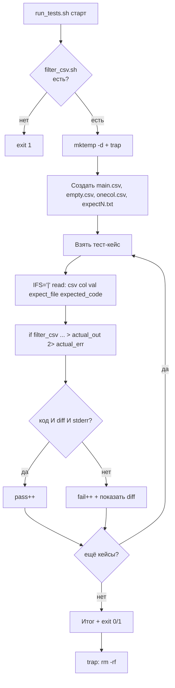

# Задача 9. Тестирование обработчика CSV

## 9.1. Входные и выходные данные

### Скрипт под тестом: `filter_csv.sh`

| Параметр | Описание |
| :--- | :--- |
| **Вход** | Три аргумента: путь к CSV, номер колонки (1-based), значение для совпадения |
| **Выход (STDOUT)** | Строки CSV, где указанная колонка равна значению (включая заголовок) |
| **Код возврата** | `0` — файл обработан (даже если совпадений ноль), `1` — ошибка входных данных |
| **STDERR** | Сообщение об ошибке при неверных входных данных |

**Правила валидности:**
- Ровно три аргумента.
- CSV-файл существует и читаем.
- Номер колонки — целое число ≥ 1.
- Номер колонки не превышает число колонок в первой строке файла.

**Формат CSV (упрощённый, без кавычек и запятых внутри полей):**
```
id,name,city
1,Ivan,Moscow
2,Petr,SPb
3,Anna,Moscow
```

**Важно:** задача упрощена — не обрабатываем экранированные запятые и кавычки. В реальном CSV это понадобилось бы, но для тренировки раннера достаточно простого `awk -F,`.

**Особенность вывода:** заголовок выводится всегда. Если совпадений нет — только заголовок. Это позволяет раннеру проверять вывод построчно.

### Раннер: `run_tests.sh`

| Параметр | Описание |
| :--- | :--- |
| **Вход** | Нет аргументов |
| **Выход (STDOUT)** | `PASS:` / `FAIL:` + итог |
| **Код возврата** | `0` — все прошли, `1` — есть провалы |

**Особенность:** раннер создаёт для каждого теста свой CSV-файл во временной директории. Это изолирует тесты друг от друга и позволяет проверить граничные случаи (пустой файл, одна колонка, неверный номер колонки).

**Сравнение многострочного вывода:** использовать `diff <(...) <(...)` — сравнение содержимого через подстановку процесса. Это надёжнее, чем строковое `==`, когда строк несколько.

---

## 9.2. Пошаговое создание `filter_csv.sh`

### Шаг 1. Шебанг и строгий режим

`#!/bin/bash` и `set -euo pipefail`.

**Рамочно:**
```bash
#!/bin/bash
set -euo pipefail
```

### Шаг 2. Проверить количество аргументов

Если `$# -ne 3` — вывести `Usage` в `stderr` и `exit 1`.

**Рамочно:**
```bash
if [ $# -ne 3 ]; then ... fi
```

### Шаг 3. Захватить аргументы

`CSV="$1"`, `COL="$2"`, `VALUE="$3"`.

### Шаг 4. Проверить, что файл существует и читаем

Если `[ ! -f "$CSV" ]` — `ERROR`, `exit 1`. Если `[ ! -r "$CSV" ]` — `ERROR`, `exit 1`.

**Рамочно:**
```bash
if [ ! -f "$CSV" ]; then ... fi
if [ ! -r "$CSV" ]; then ... fi
```

**Почему две проверки:** файл может существовать, но быть недоступным для чтения. Сообщения об ошибке разные — это помогает при отладке.

### Шаг 5. Проверить, что номер колонки — целое число ≥ 1

```bash
if [[ ! "$COL" =~ ^[0-9]+$ ]] || [ "$COL" -lt 1 ]; then
    echo "ERROR: column must be a positive integer" >&2
    exit 1
fi
```

**Разбор:**
- `^[0-9]+$` — только цифры, без знака.
- `[ "$COL" -lt 1 ]` — отсекает `0`.

**Важно:** `-lt` вызовет ошибку, если `COL` не число. Но проверка формата идёт первой через `||` — если формат неверный, второе условие не выполнится (short-circuit). Порядок важен.

### Шаг 6. Проверить, что номер колонки не превышает число колонок

Получите число колонок из первой строки:
```bash
max_cols=$(head -1 "$CSV" | awk -F, '{print NF}')
```

**Разбор:**
- `head -1 "$CSV"` — только первая строка (заголовок).
- `awk -F,` — разделитель — запятая.
- `{print NF}` — количество полей в строке.

Если `[ "$COL" -gt "$max_cols" ]` — `ERROR`, `exit 1`.

**Рамочно:**
```bash
if [ "$COL" -gt "$max_cols" ]; then ... fi
```

**Почему проверять:** `awk '$5'` на файле с тремя колонками выведет пустые строки, и вы не поймёте, что не так. Лучше явная ошибка.

### Шаг 7. Обработать CSV через `awk`

```bash
awk -F, -v col="$COL" -v val="$VALUE" '
    NR == 1 { print; next }
    $col == val { print }
' "$CSV"
```

**Разбор:**
- `-F,` — разделитель — запятая.
- `-v col="$COL"` — передать номер колонки в `awk`.
- `-v val="$VALUE"` — передать искомое значение.
- `NR == 1 { print; next }` — первая строка (заголовок) выводится всегда, дальше не обрабатывается.
- `$col == val { print }` — если поле равно значению, вывести строку.

**Почему `$col`, а не `$3`:** `awk` подставляет значение переменной `col` как номер поля. Это делает скрипт гибким.

**Важно:** `next` после `print` заголовка — чтобы не проверить заголовок на совпадение с `val`. Иначе строка `id,name,city` могла бы случайно совпасть.

### Шаг 8. Проверить, что в CSV хотя бы две строки

Если в файле только заголовок — скрипт отработает нормально (выведет заголовок). Это не ошибка. Но стоит убедиться, что файл не пустой:

```bash
if [ ! -s "$CSV" ]; then
    echo "ERROR: empty file" >&2
    exit 1
fi
```

**Рамочно:**
```bash
if [ ! -s "$CSV" ]; then ... fi
```

**Почему `-s`, а не `-f`:** `-s` проверяет, что файл не пустой. Пустой файл — ошибка входа.

**Место в скрипте:** эту проверку нужно ставить **до** получения `max_cols`, потому что `head -1` на пустом файле вернёт пустую строку, и `awk` вернёт `0` колонок.

### Шаг 9. Вывести результат и код

`awk` уже вывел результат в STDOUT. Добавьте `exit 0` в конце.

**Важно:** даже если совпадений нет, код 0 — задача выполнена. Отсутствие совпадений — не ошибка.

### Шаг 10. Сделать исполняемым и проверить вручную

`chmod +x filter_csv.sh`. Создайте тестовый CSV:
```bash
cat > /tmp/test.csv << 'EOF'
id,name,city
1,Ivan,Moscow
2,Petr,SPb
3,Anna,Moscow
EOF
```

Прогоните:
```bash
./filter_csv.sh /tmp/test.csv 3 Moscow
# id,name,city
# 1,Ivan,Moscow
# 3,Anna,Moscow

./filter_csv.sh /tmp/test.csv 3 Paris
# id,name,city

./filter_csv.sh /tmp/test.csv 5 Moscow     # ERROR, код 1
./filter_csv.sh /tmp/test.csv 0 Moscow     # ERROR, код 1
./filter_csv.sh /tmp/nope.csv 1 x          # ERROR, код 1
```

---

## 9.3. Пошаговое создание `run_tests.sh`

### Шаг 1. Шебанг и строгий режим

`#!/bin/bash` и `set -euo pipefail`.

### Шаг 2. Определить путь к целевому скрипту

`TARGET="./filter_csv.sh"`.

### Шаг 3. Проверить, что целевой скрипт существует и исполняем

`[[ -x "$TARGET" ]] || { echo "..." >&2; exit 1; }`.

### Шаг 4. Создать временную директорию и `trap`

```bash
TEST_DIR=$(mktemp -d)
trap 'rm -rf "$TEST_DIR"' EXIT
```

**Зачем:** каждый тест получит свой CSV-файл в `$TEST_DIR`. `trap` гарантирует очистку при любом исходе — в том числе при падении теста или `Ctrl+C`.

### Шаг 5. Подготовить общий CSV-файл для большинства тестов

```bash
cat > "$TEST_DIR/main.csv" << 'EOF'
id,name,city
1,Ivan,Moscow
2,Petr,SPb
3,Anna,Moscow
4,Olga,Kazan
EOF
```

**Почему общий:** большинство тестов используют один и тот же файл с разными колонками и значениями. Отдельные файлы создаются только для граничных случаев (пустой файл, одна колонка).

### Шаг 6. Подготовить особые файлы

```bash
: > "$TEST_DIR/empty.csv"
echo "onlycol" > "$TEST_DIR/onecol.csv"
```

**Разбор:**
- `: > file` — создать пустой файл. `:` — встроенная команда, которая ничего не делает; перенаправление создаёт файл.
- `onecol.csv` — файл с одной колонкой, для проверки границы.

**Зачем:** граничные случаи нельзя проверить на `main.csv`. Отдельные файлы делают тесты прозрачными.

### Шаг 7. Объявить массив тест-кейсов

Формат: `"файл|колонка|значение|ожидаемый_вывод|ожидаемый_код"`. Пять полей.

Примеры:
- `"$TEST_DIR/main.csv|3|Moscow|<заголовок + 2 строки>|0"` — есть совпадения
- `"$TEST_DIR/main.csv|3|Paris|<только заголовок>|0"` — нет совпадений
- `"$TEST_DIR/main.csv|1|2|id,name,city\n2,Petr,SPb|0"` — по первой колонке
- `"$TEST_DIR/main.csv|5|Moscow|ERROR|1"` — колонка за пределами
- `"$TEST_DIR/main.csv|0|Moscow|ERROR|1"` — колонка 0
- `"$TEST_DIR/main.csv|abc|Moscow|ERROR|1"` — не число
- `"$TEST_DIR/nope.csv|1|x|ERROR|1"` — файла нет
- `"$TEST_DIR/empty.csv|1|x|ERROR|1"` — пустой файл
- `"$TEST_DIR/onecol.csv|1|onlycol|onlycol|0"` — одна колонка, совпадение

**Проблема многострочного вывода:** хранить ожидаемый вывод с переводами строк в массиве Bash неудобно. Два подхода:

**Подход A:** хранить ожидаемый вывод в отдельном файле и сравнивать через `diff`.
**Подход B:** использовать `\n` как литерал в строке и разворачивать через `printf` или `echo -e`.

Для раннера выбираем **подход A** — он надёжнее и не зависит от экранирования.

**Структура:**
```
TESTS=(
    "main.csv|3|Moscow|expect1.txt|0"
    "main.csv|3|Paris|expect2.txt|0"
    ...
)
```

Где `expectN.txt` — файлы в `$TEST_DIR` с ожидаемым выводом. Для `ERROR`-кейсов ожидаемый вывод — пустой файл (или `ERROR` в `stderr`, см. шаг 9).

**Рамочно:**
```bash
TESTS=(
    "$TEST_DIR/main.csv|3|Moscow|$TEST_DIR/expect1.txt|0"
    ...
)
```

### Шаг 8. Создать файлы ожидаемого вывода

```bash
cat > "$TEST_DIR/expect1.txt" << 'EOF'
id,name,city
1,Ivan,Moscow
3,Anna,Moscow
EOF

cat > "$TEST_DIR/expect2.txt" << 'EOF'
id,name,city
EOF

: > "$TEST_DIR/expect_error.txt"
```

**Разбор:**
- `expect1.txt` — заголовок + 2 строки (Moscow).
- `expect2.txt` — только заголовок (Paris).
- `expect_error.txt` — пустой файл: ожидается, что STDOUT пустой (ошибка идёт в `stderr`).

### Шаг 9. Завести счётчики и номер теста

`pass=0`, `fail=0`, `n=0`.

### Шаг 10. Цикл по тест-кейсам

```bash
for t in "${TESTS[@]}"; do
    IFS='|' read -r csv col val expect_file expected_code <<< "$t"
    n=$((n + 1))
    ...
done
```

**Пять переменных:** `csv`, `col`, `val`, `expect_file`, `expected_code`.

**Почему `|`:** значения могут содержать запятые (Moscow не содержит, но если добавите `1,5` как значение — сработает). `IFS='|'` защищает от этого.

### Шаг 11. Вызвать целевой скрипт и захватить вывод и код

```bash
actual_out_file="$TEST_DIR/actual_${n}.txt"
actual_err_file="$TEST_DIR/stderr_${n}.txt"
"$TARGET" "$csv" "$col" "$val" > "$actual_out_file" 2> "$actual_err_file"
actual_code=$?
```

**Разбор:**
- Разделяем STDOUT и STDERR на разные файлы. Это позволяет проверить вывод и ошибку независимо.
- `actual_code=$?` — код возврата сразу после вызова.

**Важно про `set -e`:** здесь не используем `||` — нам нужен код возврата, а не «успех любой ценой». Но `set -e` прервёт скрипт при ненулевом коде. Решение — обернуть вызов в `if`:

```bash
if "$TARGET" "$csv" "$col" "$val" > "$actual_out_file" 2> "$actual_err_file"; then
    actual_code=0
else
    actual_code=$?
fi
```

**Почему так:** конструкция `if command; then ... else ... fi` не прерывает скрипт под `set -e`, даже если команда упала. Это стандартный приём для тестов.

### Шаг 12. Сравнить вывод, ошибку и код

```bash
if [ "$actual_code" -eq "$expected_code" ] \
   && diff -q "$expect_file" "$actual_out_file" > /dev/null \
   && { [ "$expected_code" -eq 0 ] || [ -s "$actual_err_file" ]; }; then
    echo "PASS: $t"
    pass=$((pass + 1))
else
    echo "FAIL: $t"
    echo "  ожидался код: $expected_code, получен: $actual_code"
    echo "  diff с ожидаемым выводом:"
    diff "$expect_file" "$actual_out_file" | sed 's/^/    /'
    fail=$((fail + 1))
fi
```

**Разбор:**
- `[ "$actual_code" -eq "$expected_code" ]` — коды совпали.
- `diff -q ... > /dev/null` — вывод совпал с ожидаемым файлом. `-q` — только «файлы одинаковы / различаются», без построчного diff.
- `{ [ "$expected_code" -eq 0 ] || [ -s "$actual_err_file" ]; }` — для успешных кейсов STDERR не важен; для ошибочных — должен быть не пустой (скрипт должен объяснить, что не так).

**Почему три условия:**
- Только код недостаточно: скрипт может вернуть 0 с неверным выводом.
- Только вывод недостаточно: скрипт может вернуть 1 с правильным выводом (сделал работу, но потом упал).
- Проверка STDERR — гарантия, что ошибка объяснена.

**Почему `diff`, а не `==`:** вывод многострочный. Строковое сравнение через `==` потребовало бы хранить ожидаемый вывод в переменной с `\n`, что хрупко. `diff` работает с файлами и показывает расхождения.

**Важно:** `pass=$((pass + 1))`, а не `((pass++))`.

### Шаг 13. Итоговая сводка и код возврата

```bash
echo "Итого: PASS=$pass, FAIL=$fail"
[[ $fail -eq 0 ]] || exit 1
```

### Шаг 14. Сделать исполняемым и запустить

`chmod +x run_tests.sh`. Запустите `./run_tests.sh`. Затем специально сломайте `filter_csv.sh` (например, уберите `next` после вывода заголовка — заголовок может совпасть с искомым значением) и убедитесь, что раннер поймал регрессию.

---

## 9.4. Схема работы



---

# Чек-лист для задач

- [ ] Целевой скрипт проверяет число аргументов и выводит `Usage` при ошибке.
- [ ] Целевой скрипт возвращает разные коды для успеха и провала.
- [ ] Целевой скрипт пишет ошибки в `stderr`, результат — в `stdout` (или изменяет FS).
- [ ] Раннер проверяет существование и исполняемость целевого скрипта.
- [ ] Раннер хранит тест-кейсы в массиве.
- [ ] Раннер захватывает вывод, stderr и код возврата.
- [ ] Раннер сравнивает все три.
- [ ] Раннер считает `pass`/`fail` через `$((...))`, а не `((++))`.
- [ ] Раннер возвращает `exit 1` при наличии провалов.
- [ ] Используется `diff` с файлами для многострочного вывода.
- [ ] Оба скрипта проверены через `bash -n`.
- [ ] Оба скрипта запущены вручную и показали ожидаемый результат.
- [ ] Регрессия (специально внесённая ошибка) поймана раннером.